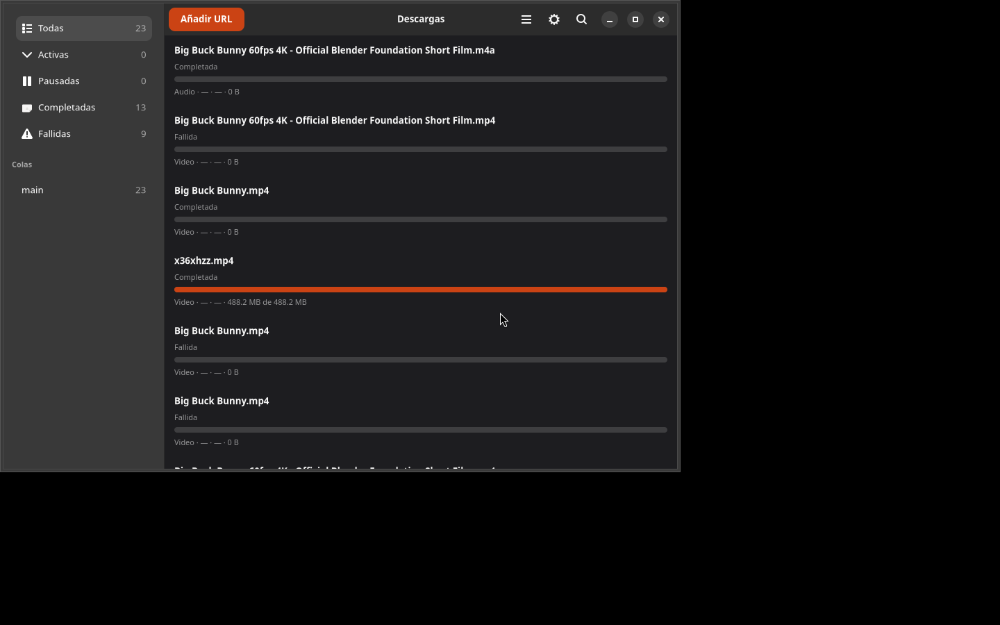
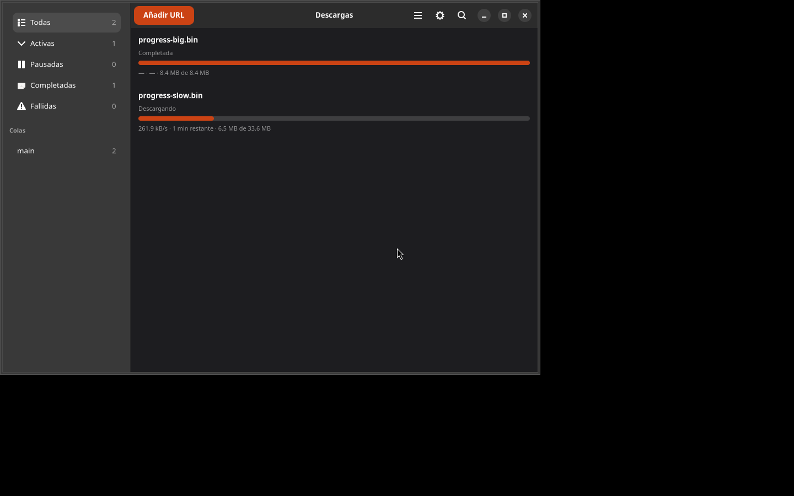
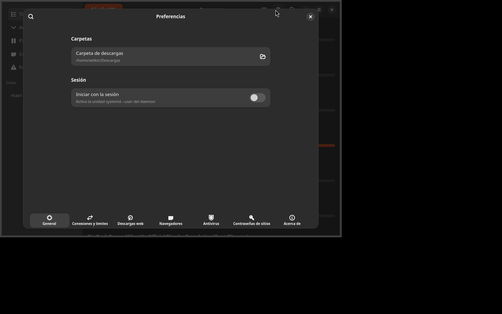
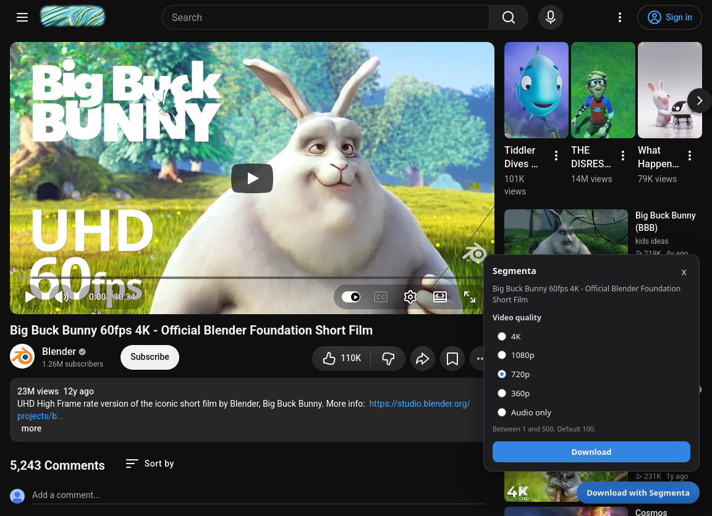
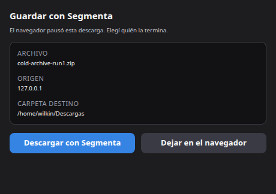

<p align="center">
  
</p>

# Segmenta

**Descargas que no se pierden cuando el navegador se cierra, la red falla o el equipo se reinicia.**

Segmenta es un gestor de descargas para **Ubuntu 26.04 LTS** con daemon propio, CLI, GUI GTK4 +
Libadwaita y extensión de navegador. Descarga HTTP/HTTPS por segmentos, torrents, YouTube y
HLS/DASH públicos; conserva el estado en SQLite y reanuda exactamente donde quedó.

[](https://github.com/wilkin-barban/Segmenta/actions/workflows/ci.yml)
[](https://github.com/wilkin-barban/Segmenta/releases/latest)
[](LICENSE)



## Qué problema resuelve

El navegador es un mal lugar para una descarga larga: si se cierra la pestaña, se suspende la
sesión o se reinicia el equipo, la descarga se pierde o vuelve a empezar. Los gestores tradicionales
tampoco coordinan la captura del navegador, las colas, los torrents y los medios en un solo lugar.

Segmenta separa la descarga del navegador y de la interfaz:

- **Estado duradero:** cada byte escrito y cada offset viven en SQLite WAL; pausar, cerrar la GUI
  o matar el daemon no pierde el progreso.
- **Velocidad real:** reparte el archivo en hasta 32 conexiones y reasigna en caliente la mitad del
  rango de un worker lento a uno que terminó.
- **Un solo punto de control:** la GUI, la CLI y la extensión hablan con el mismo daemon; podés
  cerrar la GUI y las descargas siguen.
- **Captura con confirmación:** la extensión pausa la descarga del navegador y pregunta nombre,
  host y carpeta antes de que Segmenta la adopte. Si no se puede interceptar, el archivo se queda
  en el navegador y se avisa; nunca se borra en silencio.
- **Medios y torrents incluidos:** YouTube, HLS/DASH públicos, magnet y `.torrent` comparten la
  misma cola, los mismos estados y el mismo control de progreso.

## Flujo de trabajo

1. **Instalá el daemon** con el `.deb` y habilitá `segmenta.socket` como usuario.
2. **Añadí una URL** desde la GUI (`Ctrl+N`), la CLI (`segmenta add`) o la extensión del navegador.
3. **La extensión intercepta** las descargas que coinciden con la lista configurada: pausa la copia
   del navegador y abre la confirmación. Al aceptar, crea la tarea en Segmenta y recién entonces
   elimina la copia nativa.
4. **Seguí el progreso** en la lista o en el detalle: porcentaje, velocidad, ETA y un bloque por
   segmento. La tarea más reciente aparece arriba.
5. **Pausá, reanudá o cambiá la cola** sin perder bytes; el daemon mantiene el estado aunque cierres
   la GUI.
6. **Al terminar**, Segmenta verifica el tamaño/checksum y ejecuta el post-procesamiento y el
   antivirus opcional. La tarea pasa a `completed` o falla con un código visible.

## Capturas

### Lista y progreso



La barra avanza con `task_progress`; cuando el tamaño aún es desconocido (HLS/DASH o torrent antes
de metadata) se muestra un pulso con los bytes reales, no una barra clavada en 0.

### Preferencias



Siete páginas: General, Conexiones y límites, Descargas web, Navegadores, Antivirus,
Contraseñas de sitios y Acerca.

### Extensión de YouTube



Panel de calidades con 4K, 1080p, 720p (por defecto), 360p y Solo audio.

### Confirmación de captura



La descarga del navegador ya está pausada; aceptar la adopta en Segmenta y la copia local se elimina
sólo después de que el daemon demuestra que tiene los bytes.

## Características

| Área | Qué incluye |
| --- | --- |
| Motor directo | HTTP/HTTPS segmentado, hot-split, reanudación, checksum SHA-256, límite global, reintentos con `Retry-After` y SSRF bloqueado |
| Torrents | Motor `librqbit` embebido, magnet y `.torrent`, archivos múltiples, seeding desactivado por defecto |
| Medios | YouTube (video, audio, playlists), HLS/DASH públicos con remux `ffmpeg`; DRM/AES/live fuera de alcance |
| Colas | `max_active` real, ventanas horarias y acción al completar |
| Seguridad | Secretos en Secret Service, sin credenciales en SQLite/logs, redirects cross-origin sin credenciales |
| GUI | GTK4/Libadwaita, búsqueda, filtros, detalle por segmentos, temas y notificaciones |
| CLI | `segmenta` con `--json`, códigos de salida estables y control completo sin GUI |
| Extensión | Chromium MV3 y Firefox, panel de YouTube, captura genérica, Native Messaging con allowlist |
| Paquete | `.deb` para Ubuntu 26.04+, `yt-dlp` embebido con SHA-256, instalación limpia probada en CI |

## Instalación

### Opción recomendada: Release `.deb`

Descargá el paquete y los checksums desde la
[Release v0.2.1](https://github.com/wilkin-barban/Segmenta/releases/tag/v0.2.1), luego:

```bash
sha256sum -c segmenta_0.2.1-SHA256SUMS
sudo apt install ./segmenta_0.2.1-1_amd64.deb
systemctl --user daemon-reload
systemctl --user enable --now segmenta.socket
segmenta hello
```

El paquete declara e instala sus dependencias (`ffmpeg`, `libgtk-4-1`, `libadwaita-1-0`,
`libsecret-tools`, `python3`, `ca-certificates` y `yt-dlp`). Incluye además
`/usr/share/segmenta/bin/yt-dlp` 2026.10.26, porque el paquete del archivo de Ubuntu 26.04 es
anterior al mínimo que YouTube necesita.

### Desde el código

```bash
git clone https://github.com/wilkin-barban/Segmenta.git
cd Segmenta

sudo apt-get install build-essential pkg-config libgtk-4-dev libadwaita-1-dev \
  libsecret-1-dev libssl-dev ffmpeg
packaging/fetch-ytdlp.sh
cargo build --release --workspace
cargo deb -p segmenta-gui --no-build -o dist/
packaging/check-package.sh dist/segmenta_0.2.1-1_amd64.deb 0.2.1
sudo apt install ./dist/segmenta_0.2.1-1_amd64.deb
systemctl --user daemon-reload
systemctl --user enable --now segmenta.socket
```

`segmenta.socket` crea el socket `$XDG_RUNTIME_DIR/segmenta/daemon.sock` (`0600`). Habilitá el
socket, no sólo el servicio: el daemon usa socket activation.

## Uso

### GUI

Abrí **Segmenta** desde el menú o ejecutá `segmenta-gui`.

- `Ctrl+N`: añadir URL.
- `Ctrl+F`: buscar.
- `Ctrl+,`: Preferencias.
- Menú de fila: pausar, reanudar, cancelar, eliminar y abrir carpeta.
- Menú principal: **Limpiar completadas** y **Selección múltiple** para borrar una o varias tareas
  con la casilla opcional **Eliminar también los archivos descargados**.

### CLI

```bash
# Descarga y control
segmenta add https://example.com/ubuntu.iso
segmenta list
segmenta status <task-id>
segmenta pause <task-id>
segmenta resume <task-id>

# Destino, conexiones y verificación
segmenta add https://example.com/file.zip \
  --dir ~/Descargas --name file.zip --connections 8 \
  --sha256 <hex> --queue main

# Colas y ajustes
segmenta queues list
segmenta queues create noche --max-active 1
segmenta queues schedule noche --start 02:00 --stop 06:00 --on-complete suspend
segmenta settings get
segmenta settings set max_connections 8 global_speed_limit_bps 2000000

# Medios y torrents
segmenta media probe https://www.youtube.com/watch?v=<id>
segmenta media add https://www.youtube.com/watch?v=<id> --mode video --height 720
segmenta torrent add "magnet:?xt=urn:btih:<hash>" --dir ~/Descargas

# Salida para scripts
segmenta --json list | jq '.[] | {id: .task_id, status, pct: (.downloaded_bytes / .total_bytes)}'
```

Códigos de salida: `0` éxito, `1` error del daemon/protocolo, `2` uso inválido.

### Extensión del navegador

La extensión se carga manualmente; el `.deb` instala el host nativo, los manifiestos y los ZIP,
pero no escribe perfiles del navegador.

```bash
segmenta extension status
segmenta extension prepare --family chromium   # o firefox / all
segmenta extension install-native
segmenta extension open --browser chrome
```

- **Chrome/Chromium/Brave/Edge/Vivaldi/Opera:** `chrome://extensions` → activar **Modo de
  desarrollador** → **Cargar descomprimida** → carpeta
  `~/.local/share/segmenta/extensions/chromium-<versión>`.
- **Firefox oficial:** `about:debugging#/runtime/this-firefox` → **Cargar complemento temporal**
  → `manifest.json` de `~/.local/share/segmenta/extensions/firefox-<versión>`. Firefox snap no
  puede ejecutar el host nativo.

Si una descarga pequeña termina antes de que la confirmación pueda pausarla, la extensión muestra
una notificación con la opción de añadir la URL a Segmenta. No se pierde el archivo y no queda un
fallo silencioso.

## Cómo funciona

```text
extensión / CLI / GUI
          │  JSON-RPC 2.0 (NDJSON, socket 0600)
          ▼
   segmenta-daemon ── SQLite WAL + Keyring
          │
          ├── segmenta-core: probe, scheduler, hot-split, pwrite, retry
          ├── torrents: librqbit
          ├── medios: yt-dlp / HLS / DASH / ffmpeg
          └── postproceso: hook argv + ClamAV opcional
```

La GUI no accede a la red ni a SQLite: es un cliente del daemon. Por eso podés cerrarla sin detener
las descargas y reconectarla sin perder el estado.

| Componente | Responsabilidad |
| --- | --- |
| `crates/segmenta-core` | Motor puro de sondeo, planificación, segmentos, escritura y reintentos |
| `crates/segmenta-daemon` | SQLite, IPC, colas, torrents, medios, postproceso y eventos |
| `crates/segmenta-cli` | Cliente de terminal con salida humana y `--json` |
| `crates/segmenta-gui` | Cliente GTK4/Libadwaita |
| `crates/segmenta-i18n` | Catálogos es/en/pt-BR |
| `extension/` | Extensión Chromium MV3, Firefox y tests |
| `packaging/` | `.deb`, systemd, manifiestos nativos, AppStream, icono y gates |

## Desarrollo y CI

```bash
cargo fmt --all -- --check
cargo clippy --workspace --all-targets -- -D warnings
cargo test --workspace
xvfb-run -a cargo test -p segmenta-gui
node extension/tests/run.mjs
node extension/tools/sync-shared.mjs --check
node extension/tools/pack.mjs --check
```

El workflow de GitHub Actions corre esos gates, construye el `.deb` y lo instala en un contenedor
**Ubuntu 26.04** limpio; también comprueba que la GUI arranque bajo Xvfb y que el `yt-dlp` embebido
sea reciente.

## Estado y límites

- **v0.2.1 publicada**: [Release y assets](https://github.com/wilkin-barban/Segmenta/releases/tag/v0.2.1).
- La extensión se carga manualmente; Chrome estable no instala una extensión externa sin tienda ni
  política, y Firefox snap no ejecuta el host nativo.
- Una descarga extremadamente pequeña puede completarse antes de que el service worker pueda
  pausarla; en ese caso se notifica y se ofrece añadirla a Segmenta.
- Sin DRM, AES-128, streams en vivo, subtítulos ni multi-audio.
- `.deb` para Ubuntu 26.04+; no hay Flatpak, Snap, AppImage, Windows ni macOS.

## Documentación

- [`CHANGELOG.md`](CHANGELOG.md) — historial completo por versión.
- Notas de release: [0.2.1](packaging/release-notes-0.2.1.md) · [0.2.0](packaging/release-notes-0.2.0.md) · [0.1.2](packaging/release-notes-0.1.2.md) · [0.1.1](packaging/release-notes-0.1.1.md) · [0.1.0](packaging/release-notes-0.1.0.md).
- [`docs/openspec/`](docs/openspec/) — contratos de arquitectura, motor, IPC, persistencia, extensión y empaquetado.
- [`docs/qa/`](docs/qa/) — evidencia de QA en Ubuntu.
- [`odd/tasks/`](odd/tasks/) — planes y evidencia ODD por release.

Licencia: **GPL-3.0-or-later** (ver [`LICENSE`](LICENSE)).
