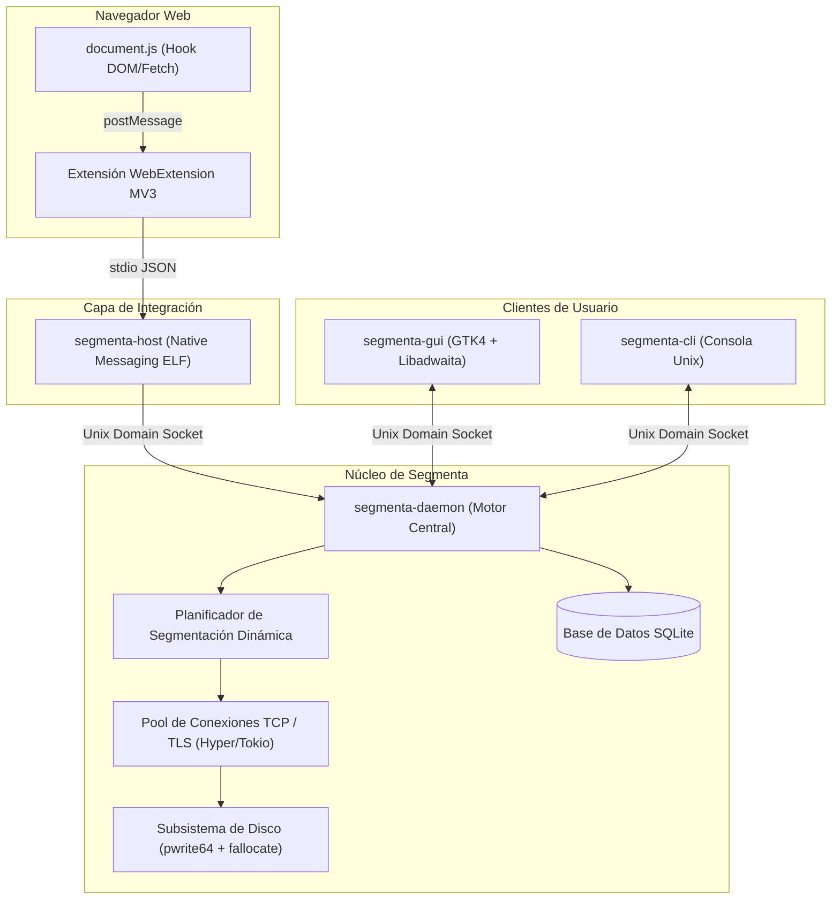

# OpenSpec 01: Arquitectura General del Sistema e IPC

> **Especificación:** OPENSPEC-SEGMENTA-001  
> **Versión:** 1.0.0  
> **Público Objetivo:** Agentes Autónomos y Desarrolladores de Software de Sistemas

> **Contratos normativos:** 06 (HTTP), 07 (IPC), 08 (persistencia y hot-split), 09
> (extensión y Native Messaging) y 10 (empaquetado y pruebas). Si este documento resume algo
> que aquellos detallan, prevalecen los documentos específicos; en particular, el DDL de 08
> reemplaza el esquema ilustrativo que antes vivía aquí.

---

## 1. Visión General de la Arquitectura

**Segmenta** se estructura siguiendo la filosofía Unix de separación estricta entre el **demonio de descargas (*engine*)**, la **interfaz de usuario (*GUI/CLI*)** y el **conector con navegadores (*browser bridge*)**.



---

## 2. Definición de Procesos del Sistema

### 2.1. `segmenta-daemon` (El Motor de Descarga)
* **Tipo:** Servicio en espacio de usuario (*User Systemd Service* o inicio automático en sesión).
* **Responsabilidades:**
  * Administrar la cola de descargas y prioridades.
  * Ejecutar el algoritmo de segmentación dinámica en caliente.
  * Realizar las llamadas de red asíncronas con buffers reciclados (*zero-allocation buffers*).
  * Controlar la persistencia de transacciones en disco (puntos de reanudación).
  * Alojar el servidor IPC en un Unix Domain Socket.

### 2.2. `segmenta-gui` (La Interfaz Gráfica)
* **Tipo:** Aplicación de escritorio nativa GNOME/Wayland.
* **Tecnología:** GTK4 + Libadwaita.
* **Responsabilidades:**
  * Representación visual de descargas activas, pausadas y completadas.
  * Widget personalizado de visualización de segmentos en tiempo real.
  * Captura de acciones del usuario (añadir, pausar, cancelar, limitar velocidad global).
  * Integración con portales de Freedesktop: selector de archivos nativo, modo oscuro del sistema, y notificaciones de escritorio.

### 2.3. `segmenta-host` (El Puente Native Messaging)
* **Tipo:** Binario ejecutable ELF sin dependencias pesadas.
* **Ruta de Instalación:**
  * Chrome/Chromium: `~/.config/google-chrome/NativeMessagingHosts/io.github.wilkin.segmenta.json`
  * Firefox: `~/.mozilla/native-messaging-hosts/io.github.wilkin.segmenta.json`
* **Mecanismo:**
  1. Es lanzado por el navegador vía `stdin`/`stdout`.
  2. Decodifica el mensaje JSON con prefijo de longitud de 32 bits en little-endian.
  3. Abre una conexión al Unix Domain Socket de `segmenta-daemon`.
  4. Reenvía el paquete de descarga con cookies y cabeceras.
  5. Cierra o mantiene el canal según corresponda y reporta éxito al navegador.

### 2.4. `segmenta-cli` (Control por Terminal)
* Permite controlar el daemon desde la línea de comandos (`segmenta add <URL>`, `segmenta list`, `segmenta pause <ID>`). Ideal para automatización en scripts bash y entornos headless.

---

## 3. Protocolo de Comunicación Inter-Procesos (IPC)

El contrato completo —métodos, parámetros, errores, eventos, framing y ciclo de vida— está en
[`07-ipc-contract.md`](07-ipc-contract.md). Lo que sigue es sólo el mapa de transporte.

### 3.1. Transporte y Ubicación
* **Ruta del Socket Unix:**  
  `$XDG_RUNTIME_DIR/segmenta/daemon.sock`  
  (Si `$XDG_RUNTIME_DIR` no está definido, usar `/tmp/segmenta-$UID/daemon.sock` con permisos `0700`).
* **Formato de Mensajes:** Mensajes delimitados por nueva línea (NDJSON) basados en el estándar **JSON-RPC 2.0**.

---

### 3.2. Esquema de Métodos JSON-RPC

#### A. `download.add` (Petición)
Enviado por la extensión de navegador, la GUI o la CLI para registrar una nueva tarea de descarga.

```json
{
  "jsonrpc": "2.0",
  "id": "req-001",
  "method": "download.add",
  "params": {
    "url": "https://example.com/iso/ubuntu-26.10-desktop.iso",
    "filename": "ubuntu-26.10-desktop.iso",
    "destination_dir": "/home/usuario/Descargas",
    "headers": {
      "User-Agent": "Mozilla/5.0 (X11; Ubuntu; Linux x86_64; rv:130.0) Gecko/20100101 Firefox/130.0",
      "Referer": "https://example.com/downloads",
      "Authorization": "Bearer eyJhbGciOi..."
    },
    "cookies": [
      {
        "name": "session_id",
        "value": "xyz789",
        "domain": ".example.com",
        "path": "/"
      }
    ],
    "connections": 16,
    "start_immediately": true
  }
}
```

#### B. `download.add` (Respuesta)
```json
{
  "jsonrpc": "2.0",
  "id": "req-001",
  "result": {
    "task_id": "c1f7a28e-8b1b-4f9e-9d22-29f123456789",
    "status": "probing",
    "filename": "ubuntu-26.10-desktop.iso"
  }
}
```

#### C. `download.event` (Notificación Push del Daemon a Clientes Conectados)
El daemon emite eventos en tiempo real hacia la GUI para actualizar las barras de progreso y los segmentos:

```json
{
  "jsonrpc": "2.0",
  "method": "download.event",
  "params": {
    "event": "segment_progress",
    "task_id": "c1f7a28e-8b1b-4f9e-9d22-29f123456789",
    "total_size": 4294967296,
    "downloaded_bytes": 1073741824,
    "speed_bps": 52428800,
    "eta_seconds": 61,
    "segments": [
      {
        "segment_id": 1,
        "start_offset": 0,
        "end_offset": 1073741823,
        "next_offset": 1073741824,
        "status": "completed",
        "speed_bps": 0
      },
      {
        "segment_id": 2,
        "start_offset": 1073741824,
        "end_offset": 2147483647,
        "next_offset": 1450000000,
        "status": "downloading",
        "speed_bps": 26214400
      },
      {
        "segment_id": 3,
        "start_offset": 2147483648,
        "end_offset": 4294967295,
        "next_offset": 2400000000,
        "status": "downloading",
        "speed_bps": 26214400
      }
    ]
  }
}
```

#### D. Métodos de Control y Configuración
* `download.pause` -> `{"method": "download.pause", "params": {"task_id": "..."}}`
* `download.resume` -> `{"method": "download.resume", "params": {"task_id": "..."}}`
* `download.cancel` -> `{"method": "download.cancel", "params": {"task_id": "...", "delete_file": false}}`
* `settings.get` -> `{"method": "settings.get"}` (Retorna todas las opciones de configuración)
* `settings.update` -> `{"method": "settings.update", "params": {"max_connections": 16, "global_speed_limit_bps": 10485760, ...}}`
* `queue.schedule` -> `{"method": "queue.schedule", "params": {"start_time": "02:00", "stop_time": "06:00", "action_on_complete": "power_off"}}`

---

## 4. Persistencia y Recuperación de Fallos (SQLite WAL)

La base de datos se almacena en `$XDG_DATA_HOME/segmenta/segmenta.db`, con el esquema normativo de
[`08-persistence-recovery.md`](08-persistence-recovery.md).
* **Modo de Diario:** `PRAGMA journal_mode = WAL;` (permite lecturas concurrentes sin bloquear escrituras del motor).
* **Esquema de Tablas:** el DDL normativo, los índices, los pragmas y las reglas de aislamiento viven en
  [`08-persistence-recovery.md`](08-persistence-recovery.md). No se duplica aquí: el esquema anterior
  (`current_offset`, `headers_cookies`, `site_logins.secret_token`) quedó reemplazado por la versión
  transaccional de 08, que usa `next_offset`, una tabla de secretos por tarea y el llavero de GNOME.

### Protocolo de Reanudación Post-Cierre o Caída de Corriente
1. Al arrancar `segmenta-daemon`, se consulta la tabla `downloads` filtrando por `status = 'downloading'`.
2. Las descargas incompletas se marcan como `paused`.
3. Al pulsar `resume`:
   * Se lee el estado de cada segmento en la tabla `segments`.
   * Para cada segmento incompleto, `next_offset` es el próximo byte a escribir (convención de 08).
   * Se envía `Range: bytes={next_offset}-{end_offset}` con `If-Range` cuando exista validador.
   * La descarga continúa exactamente donde se detuvo, después de validar que el archivo remoto no cambió.
