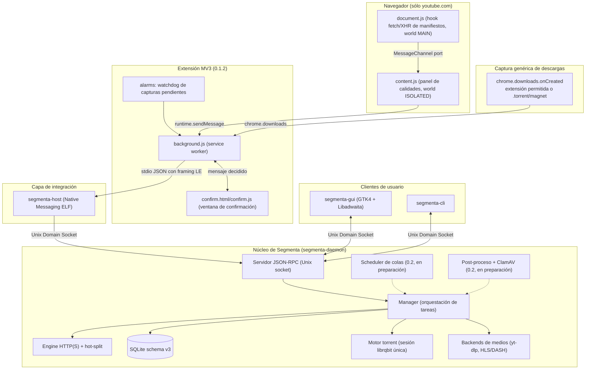

# OpenSpec 01: Arquitectura General del Sistema e IPC

> **Especificación:** OPENSPEC-SEGMENTA-001  
> **Versión:** 1.2.0  
> **Público Objetivo:** Agentes Autónomos y Desarrolladores de Software de Sistemas

> **Contratos normativos:** 06 (HTTP), 07 (IPC), 08 (persistencia y hot-split), 09
> (extensión y Native Messaging) y 10 (empaquetado y pruebas). Si este documento resume
> algo que aquellos detallan, prevalecen los documentos específicos; en particular, el DDL
> de 08 reemplaza el esquema ilustrativo que antes vivía aquí y el catálogo de métodos de 07
> prevalece sobre la tabla de §3.2.
>
> **12 (scheduler, post-proceso y site logins)** es el documento normativo de esas tres
> piezas en 0.2.0 y **todavía no existe** en `docs/openspec/`: lo que §7 y §8 describen es el
> contrato objetivo de la release, no comportamiento entregado.

> **Alcance de esta revisión:** la versión publicada es **0.1.2** (`Cargo.toml`,
> `extension/*/manifest.json`) y **0.2.0 está en preparación**. Todo lo que aquí se describe sin
> etiqueta existe hoy en `crates/` y `extension/` en `main`; varias piezas ya presentes
> (reconciliación de cold-start de la extensión, probe multiarchivo de torrents, `--help`
> completo) pertenecen a 0.2.0 y todavía no se han publicado. Lo que 0.2.0 promete y **no existe**
> todavía en el árbol —scheduler de colas, `max_active` real, post-proceso, ClamAV, site
> logins— se marca con **«(0.2, en preparación)»** en la misma frase y no debe leerse como
> comportamiento entregado.

---

## 1. Visión General de la Arquitectura

**Segmenta** se estructura siguiendo la filosofía Unix de separación estricta entre el **demonio de descargas (*engine*)**, la **interfaz de usuario (*GUI/CLI*)** y el **conector con navegadores (*browser bridge*)**.

### 1.1. Componentes y estado real

| Componente | Estado | Dónde vive |
| --- | --- | --- |
| Daemon con engine HTTP(S) segmentado y hot-split | Implementado | `crates/segmenta-daemon`, `crates/segmenta-core/src/{engine,planner,disk,probe}.rs` |
| Persistencia SQLite (`user_version = 3`) | Implementado | `crates/segmenta-daemon/src/{store.rs,schema.sql}` |
| Motor torrent con `librqbit` (magnet y `.torrent`) | Implementado | `crates/segmenta-daemon/src/torrent.rs` |
| Backends de medios: YouTube (`yt-dlp`) y HLS/DASH públicos | Implementado | `crates/segmenta-daemon/src/{media.rs,stream_media.rs}` |
| Extensión MV3: sniffer **sólo YouTube** + captura genérica de descargas | Implementado | `extension/{chromium,firefox}` |
| Host de Native Messaging | Implementado | `crates/segmenta-host` |
| GUI GTK4/Libadwaita y CLI | Implementados | `crates/segmenta-gui`, `crates/segmenta-cli` |
| Detección/preparación de extensiones por navegador | Implementado | `crates/segmenta-daemon/src/browsers.rs` |
| Scheduler de colas y `max_active` real | **0.2, en preparación** | `crates/segmenta-daemon/src/scheduler.rs` (no existe todavía) |
| Post-proceso por argv y ClamAV con cuarentena | **0.2, en preparación** | `crates/segmenta-daemon/src/postprocess.rs` (no existe todavía) |
| Site logins Basic + GNOME Keyring | **0.2, en preparación**: la tabla `site_logins` y el llavero ya existen, faltan RPC y UI | `manager.rs`/`rpc.rs`/`prefs.rs` |
| Categorías automáticas de descarga | **Retiradas**: sólo lectura legacy de `category_dirs` | `store.rs`, `prefs.rs` |

---

## 2. Definición de Procesos del Sistema

### 2.1. `segmenta-daemon` (El Motor de Descarga)
* **Tipo:** Servicio en espacio de usuario (*User Systemd Service*, activable por socket mediante `segmenta.socket`), o ejecución directa para desarrollo.
* **Instancia única:** mantiene un `flock` exclusivo sobre `$XDG_RUNTIME_DIR/segmenta/daemon.lock`; un segundo proceso termina con `ERR_DAEMON_ALREADY_RUNNING`.
* **Responsabilidades:**
  * Alojar el servidor IPC en un Unix Domain Socket (`ipc.rs`) y despachar los métodos en `manager.rs`.
  * Administrar la cola de descargas, prioridades y el estado de cada tarea.
  * Ejecutar el algoritmo de segmentación dinámica en caliente (`segmenta-core::planner`).
  * Realizar las llamadas de red asíncronas con `reqwest`/`tokio` y escribir en disco con `pwrite64` + `posix_fallocate`.
  * Persistir el checkpoint transaccional de cada segmento en SQLite (WAL).
  * Sostener **una sola sesión `librqbit` por proceso** para todos los torrents (§5).
  * Ejecutar los backends de medios (`yt-dlp`, HLS/DASH) como procesos externos sin shell.
  * Emitir eventos en tiempo real por el bus interno hacia la GUI y los clientes conectados.
* **Lo que el daemon no hace hoy:** no aplica ventanas horarias ni `max_active`, y **no ejecuta** ningún post-proceso ni antivirus; `postprocess_command` se persiste pero no se lanza. Ambas cosas son **(0.2, en preparación)** (§7 y §8).

### 2.2. `segmenta-gui` (La Interfaz Gráfica)
* **Tipo:** Aplicación de escritorio nativa GNOME/Wayland (GTK4 + Libadwaita, `adw::Application` con ID `io.github.wilkin.Segmenta`).
* **Responsabilidades:**
  * Representación visual de descargas por filtro (`Todas`, `Activas`, `Pausadas`, `Completadas`, `Fallidas`) y por cola; no hay filtros por categoría.
  * Widget propio de segmentos en vivo (`SegmentaSegmentView`, §3 de 04).
  * Captura de acciones del usuario (añadir, pausar, reanudar, cancelar, borrar, abrir carpeta).
  * Ventana de Preferencias que escribe cada cambio con `settings.update`.
  * Notificaciones de escritorio vía `gio::Notification` al completarse o fallar una tarea (sin botones de acción).
* **Transporte:** un `UnixStream` bloqueante en un hilo trabajador con reconexión; la GUI nunca abre el socket del daemon para otros fines ni descarga por su cuenta.

### 2.3. `segmenta-host` (El Puente Native Messaging)
* **Tipo:** Binario ejecutable ELF sin dependencias pesadas (`/usr/bin/segmenta-host`).
* **Ruta de los manifiestos de usuario** (escritos por `extension.install-native` o por
  `extension/install-native.sh`):
  * Chromium: `~/.config/<browser>/NativeMessagingHosts/io.github.wilkin.segmenta.json`
  * Firefox: `~/.mozilla/native-messaging-hosts/io.github.wilkin.segmenta.json`
  * De sistema (los instala el `.deb`): `/etc/opt/chrome/...`, `/etc/chromium/...`, `/etc/opt/edge/...`, `/etc/brave/...`, `/etc/vivaldi/...`, `/etc/opera/...` y, para Firefox, `/usr/lib/mozilla/native-messaging-hosts/io.github.wilkin.segmenta.json`.
  * Inconsistencia abierta (verificada, no corregida en este documento): `extension/install-native.sh --print`
    anuncia la ruta de Firefox bajo `$XDG_CONFIG_HOME/mozilla/native-messaging-hosts/`, que Firefox no
    consulta; sólo la variante Rust (`extension.install-native`) usa `~/.mozilla`.
* **Mecanismo:**
  1. Es lanzado por el navegador vía `stdin`/`stdout`.
  2. Decodifica el mensaje JSON con prefijo de longitud de 32 bits en little-endian.
  3. Rechaza cualquier método fuera de la allowlist `media.`, `system.`, `download.`, `settings.` y `torrent.` (`proxy.rs`).
  4. Abre el Unix Domain Socket del daemon; si no responde, activa `segmenta.socket` con `systemctl --user start`.
  5. Reenvía el sobre JSON-RPC tal cual y devuelve al navegador la respuesta con el mismo framing, con un timeout de 30 s por ida y vuelta.
* **Importante:** el host no recolecta cookies ni cabeceras por su cuenta; sólo reenvía lo que la extensión ya validó.

### 2.4. `segmenta-cli` (Control por Terminal)
* Controla el daemon desde la línea de comandos: `add`, `list`, `status`, `pause`, `resume`, `cancel`, `delete`, `settings`, `queues`, `media`, `torrent`, `extension`, `hello`, `system`.
* Subcomandos y flags reales son los de `crates/segmenta-cli/src/cli.rs`.
* **`--help`:** se genera desde la propia definición de clap (`help_text` en `cli.rs`), en
  `es`/`en`/`pt-BR`, y documenta cada subcomando y cada flag que el parser acepta —
  `extension` incluido—, de modo que la ayuda no puede desviarse del parser. Un test
  (`crates/segmenta-cli/tests/cli_help.rs`) deriva la lista esperada del propio clap y la
  compara con el texto renderizado; lo cerró la tarea R3 (`9024726`).

### 2.5. Extensión de navegador (0.1.2)
* **Manifiestos separados:** `extension/chromium/manifest.json` (MV3 con `key` fija, ID `kdeldnifdbpemnhfpmhonlnibbhnoaan`) y `extension/firefox/manifest.json` (`browser_specific_settings.gecko.id = segmenta@wilkin.github.io`).
* **Permisos reales:** `nativeMessaging`, `storage`, `scripting`, `activeTab`, `downloads`, `contextMenus`, `notifications`, `alarms`; `host_permissions` limitado a `https://www.youtube.com/*` y `optional_host_permissions` `https://*/*`. No pide `cookies`.
* **Dos caminos de captura distintos y no intercambiables** (§6): sniffer de YouTube y captura genérica de descargas del navegador.

---

## 3. Protocolo de Comunicación Inter-Procesos (IPC)

El contrato completo —métodos, parámetros, errores, eventos, framing y ciclo de vida— está en
[`07-ipc-contract.md`](07-ipc-contract.md). Lo que sigue es sólo el transporte y el catálogo de
métodos **que el daemon despacha hoy**; los ejemplos de payload viven en 07, no aquí.

### 3.1. Transporte y Ubicación
* **Ruta del Socket Unix:**  
  `$XDG_RUNTIME_DIR/segmenta/daemon.sock`  
  (Si `$XDG_RUNTIME_DIR` no está definido, usar `/tmp/segmenta-$UID/daemon.sock` con permisos `0700`).
* **Formato de Mensajes:** Mensajes delimitados por nueva línea (NDJSON) basados en el estándar **JSON-RPC 2.0**, con un máximo de 1 MiB por mensaje.
* **Autorización:** el servidor compara el `SO_PEERCRED` del cliente con el UID del daemon.

### 3.2. Métodos despachados (estado 0.1.2)

| Método | Función |
| --- | --- |
| `system.hello` | Versión de protocolo y del daemon. |
| `system.status` | Estado agregado del daemon. |
| `system.shutdown` | Cancela las tareas activas y apaga el daemon. |
| `system.open` | Enfoca una tarea en la GUI (`segmenta-gui` con argv fijo). |
| `download.add` | Registra una descarga HTTP(S) (`url`, `destination_dir`, `filename`, `headers`, `cookies`, `connections`, `expected_checksum`, `start_immediately`, `queue_name`, `priority`). |
| `download.list` / `download.status` | Listado paginado y detalle con segmentos. |
| `download.pause` / `download.resume` / `download.cancel` / `download.delete` | Control del ciclo de vida; `cancel`/`delete` aceptan `delete_file`. |
| `media.probe` / `media.add` / `media.status` | YouTube por `yt-dlp` y manifiestos HLS/DASH públicos. |
| `torrent.probe` / `torrent.add` / `torrent.status` | Motor torrent (§5). |
| `extension.status` / `extension.prepare` / `extension.open` / `extension.install-native` | Detección de navegadores, preparación del ZIP, apertura de la página de extensiones e instalación del manifiesto nativo de usuario. |
| `settings.get` / `settings.update` | Ajustes persistidos (§4). |
| `queue.list` / `queue.create` / `queue.remove` / `queue.schedule` | Colas y su horario **persistido**; el horario todavía no se ejecuta (§7). |

* **Métodos retirados de esta especificación:** el catálogo extenso con ejemplos de `download.add`,
  `download.event`, `settings.update` y `queue.schedule` que vivía aquí duplicaba 07 y describía
  parámetros que ya cambiaron (por ejemplo `queue.schedule` exige hoy `queue_name`). Se elimina; 07
  es la única fuente.
* **(0.2, en preparación)** añadirá al catálogo `site_login.list`, `site_login.set` y
  `site_login.remove`, además del efecto real de `queue.schedule` sobre el arranque de pendientes.

### 3.3. Eventos
El daemon publica eventos por un `tokio::sync::broadcast` interno (buffer de 1024 eventos) que el
servidor IPC reenvía como notificación JSON-RPC `download.event` (sin `id`). Los `event_type` que el
daemon emite hoy son: `task_added`, `task_started`, `state_changed`, `segment_started`,
`segment_split`, `segment_completed`, `task_progress` (como máximo cuatro por segundo y por
descarga, `PROGRESS_INTERVAL = 250 ms`), `task_completed`, `task_cancelled`, `task_failed` y
`download_restarted_due_to_stale_cache`. El payload mínimo de cada uno está en 07 §5.1.

Además, un cliente que se atrasa en el canal acotado recibe `system.resync_required` —una
notificación, no un método— y debe recargar con `download.list`. El host de Native Messaging
reenvía las notificaciones sin `id` al navegador.

---

## 4. Persistencia y Recuperación de Fallos (SQLite WAL)

La base de datos se almacena en `$XDG_DATA_HOME/segmenta/segmenta.db`, con el esquema normativo de
[`08-persistence-recovery.md`](08-persistence-recovery.md).
* **Modo de Diario:** `PRAGMA journal_mode = WAL;` (permite lecturas concurrentes sin bloquear escrituras del motor).
* **Versión de esquema:** `PRAGMA user_version = 3` (`store::SCHEMA_VERSION`), con rebuilds
  encadenados v1 → v2 (medios) → v3 (torrents).
* **Tablas vigentes:** `queues`, `downloads`, `download_headers`, `download_secrets`, `segments`,
  `download_stream_plan`, `settings`, `site_logins`, `torrents`, `torrent_files`.
* **Secretos:** nunca en SQLite. `download_secrets` y `site_logins` guardan sólo el alias del
  secreto (`keyring_secret_id`). El backend es el Secret Service de GNOME a través de `secret-tool`
  (`KeyringSecretStore`, `secrets.rs`); se considera disponible si
  `secret-tool lookup service segmenta key __segmenta_probe__` sale con `0` o `1`.
* **Sin keyring no hay alternativa en claro:** si no hay Secret Service, `secrets.rs` devuelve
  `UnavailableSecretStore`, `store()` falla y el alta se rechaza con
  `1031 ERR_KEYRING_UNAVAILABLE`. No existe un fichero de secretos de reserva: el fichero plano de
  0.0.1 sólo se **migra** al llavero (`migrate_legacy_file`) y se borra, nunca se vuelve a escribir.
* **Campos retirados:** el esquema anterior (`current_offset`, `headers_cookies`,
  `site_logins.secret_token`) ya no existe; la versión transaccional usa `next_offset`, una tabla de
  secretos por tarea y el alias del llavero.
* **(0.2, en preparación)** el esquema subirá a **v4** para `quarantine_path`,
  `postprocess_exit` y `postprocess_message`; hoy esas columnas **no existen** y el DDL de 08 sigue
  siendo el vigente.

### 4.1. Protocolo de reanudación tras cierre o caída de corriente
1. Al arrancar `segmenta-daemon`, `Manager::recover` consulta la tabla `downloads` filtrando por las tareas que quedaron activas.
2. Las descargas incompletas se marcan como `paused`.
3. Al pulsar `resume`:
   * Se lee el estado de cada segmento en la tabla `segments`.
   * Para cada segmento incompleto, `next_offset` es el próximo byte a escribir (convención de 08).
   * Se envía `Range: bytes={next_offset}-{end_offset}` con `If-Range` cuando exista validador.
   * La descarga continúa exactamente donde se detuvo, después de validar que el archivo remoto no cambió.

---

## 5. Motor Torrent (`torrent.rs`, implementado)

* **Sesión única:** `torrent::shared_session` crea **una** `librqbit::Session` por proceso con
  `tokio::sync::OnceCell`; el directorio de salida es el de la primera tarea que la necesita. No se
  crea una sesión por tarea ni por chunk.
* **Fuentes aceptadas:** `magnet:` y URLs `.torrent` servidas por HTTP(S); el `.torrent` se descarga
  con el cliente HTTP del daemon y se decodifica con `librqbit_bencode` (`TorrentMetaV1`).
* **Probe:** `torrent.probe` devuelve `name`, `info_hash`, `total_bytes`, `files[]` y `source_type`.
  * `.torrent` **multiarchivo** (`info.files`): `total_bytes` es la suma de las longitudes, `name`
    viene de `info.name` y hay una entrada de `files[]` por archivo, con `index` contiguo, `path`
    saneado componente a componente, `length` y `selected: true`. Antes de aceptar el total se
    valida que `info.pieces` declare exactamente un hash de 20 bytes por trozo (tarea R2,
    `d7075a6`).
  * `.torrent` de archivo único (`info.length`, sin `files`): conserva la forma de 0.1.x, con
    `total_bytes = info.length` y exactamente una entrada en `files[]`.
  * `magnet:` sólo aporta `name`; `total_bytes` es `null` y `files` viene vacío hasta que la
    sesión resuelve los metadatos.
  * **Límite real:** `info_hash` vuelve **siempre** como cadena vacía —el hash no se calcula, ni
    siquiera para un `.torrent`—.
* **Arranque:** `torrent.add` repite el probe del origen, persiste la tarea con `download_type`
  `torrent` o `magnet`, inserta la fila en `torrents` (con el `info_hash` del probe o 40 ceros
  cuando viene vacío) y **una sola** fila en `torrent_files` (`index 0`, ruta derivada del nombre
  del torrent, `files_count = 1`), y lanza el trabajo en la sesión compartida reportando progreso
  cada 500 ms.
* **Semillas:** `seed_after_complete` existe como columna y como parámetro, pero `run_torrent`
  termina en cuanto el payload está completo; cancelar borra el torrent de la sesión sin tocar los
  datos.
* **Rutas:** `sanitize_torrent_path` rechaza rutas absolutas, `..` y componentes inválidos, y cada
  componente pasa por `segmenta-core::filename::sanitize_filename`.
* **Límite conocido:** el probe ya informa el conjunto completo de archivos, pero la persistencia
  sigue siendo de un archivo: `torrent_files` guarda una única fila (`index 0`) y `torrents`
  escribe `files_count = 1`, así que `torrent.status` no enumera un torrent multiarchivo. R2 sólo
  cubrió el probe; completar la persistencia multiarchivo sigue pendiente y no está asignada en
  `odd/tasks/segmenta-0.2.md`.

---

## 6. Captura desde el navegador (dos caminos separados)

El detalle normativo está en [`03-browser-extension-and-native-messaging.md`](03-browser-extension-and-native-messaging.md).

### 6.1. Sniffer multimedia — sólo YouTube
* `document.js` (world `MAIN`) intercepta `fetch` y `XMLHttpRequest` y sólo reporta URLs que
  terminen en `.m3u8` o `.mpd`; entrega la URL por un `MessagePort` privado, nunca con
  `postMessage("*")`.
* `content.js` (world `ISOLATED`) sólo se inyecta en `https://www.youtube.com/*`; muestra el botón
  flotante **sólo tras un click** del usuario y luego pide `media.probe`.
* **No existe ningún adaptador de Vimeo, Twitter/X, Netflix ni de otro sitio**, y el sniffer no
  intenta capturar páginas arbitrarias. Un `https://*/*` opcional existe únicamente para el permiso
  futuro de sitios de streaming; hoy la lista `STREAM_ALLOWLIST` está vacía.

### 6.2. Captura genérica de descargas
* `background.js` escucha `chrome.downloads.onCreated` y decide con los ajustes del daemon:
  `capture_enabled`, `domain_denylist` (host exacto o subdominio), `capture_torrents`,
  `capture_magnet` y `capture_extensions` (por extensión del nombre de archivo, con comodín final
  `r0*`).
* Ignora descargas creadas por la propia extensión y esquemas que no son `http(s)` ni `magnet:`.
* Con `capture_confirm` activo (valor por defecto del daemon) el flujo es **pausar → confirmar →
  añadir → borrar tras verificar bytes**; sin confirmación el mismo flujo se ejecuta sin ventana.
* El archivo del navegador **nunca se cancela antes** de que el daemon demuestre que tiene bytes:
  la propiedad se comprueba con `media.status` (hasta 60 s, cada 1 s) y, si no se demuestra, se
  reanuda la copia del navegador. Detalle normativo en 03 §5.2.

### 6.3. HLS/DASH fuera del sniffer
`media.add` acepta manifiestos HLS/DASH públicos por URL directa (CLI o GUI) y los descarga con el
pipeline interno (`stream_media.rs`): resuelve la variante, baja el init y los fragmentos **en
orden y de uno en uno** en el propio daemon, y los une con `ffmpeg -c copy` (argumentos separados,
nunca un shell). Esto **no** amplía el sniffer: la extensión no envía manifiestos de sitios que no
sean YouTube.

---

## 7. Scheduler de colas y `max_active` (0.2, en preparación)

Hoy el daemon **no** ejecuta horarios ni límites por cola: `queue.schedule` sólo valida que la cola
exista y persiste `queue_schedule:<name>` en `settings`; `queues.max_active` se guarda (1–8, default
3 para `main`) y se informa en `queue.list`, pero ningún bucle lo aplica, y las tareas arrancan
cuando se piden (`start_immediately`) o al reanudarlas.

El contrato objetivo —que detallará 12 **(0.2, en preparación)**, todavía sin archivo— es:

* un `QueueScheduler` como tarea `tokio` iniciada junto al servidor IPC, con tick corto;
* ventana horaria local por cola (`start_time`/`stop_time` en `HH:MM`) y campos legacy
  `schedule_start`/`schedule_stop` para `main`;
* arranque centralizado de pendientes con `max_active` aplicado **antes** de lanzar la tarea y
  liberación del slot al terminar, fallar o cancelar;
* `action_on_complete` (`none`, `suspend`, `power_off`, `exit`) ejecutada **sólo** cuando la cola
  queda vacía;
* límite explícito: el scheduler sólo corre mientras el daemon está activo.

---

## 8. Post-proceso y antivirus (0.2, en preparación)

Hoy existe el ajuste `postprocess_command: Vec<String>` en `settings.get`/`settings.update` y en el
modelo de la GUI, pero **el daemon nunca lo ejecuta** y no hay ClamAV, ni cuarentena, ni columna
`quarantine_path`, ni código de error `ERR_ANTIVIRUS_*`.

El contrato objetivo —que detallará 12 **(0.2, en preparación)**, todavía sin archivo— es:

* hook argv sin shell, con sustitución de `%file%`, `%folder%` y `%name%`, timeout configurable y
  salida acotada;
* settings nuevos `antivirus_enabled` (default `false`), `antivirus_timeout_secs` y
  `antivirus_quarantine_dir`;
* detección de `clamdscan` y, en su defecto, `clamscan`; motor ausente ⇒ tarea `failed` con código
  estable, nunca `completed`;
* infección ⇒ mover a cuarentena, `failed` con `ERR_ANTIVIRUS_FOUND` y ningún archivo en Descargas;
* estados de tarea extendidos en la GUI («En cuarentena» con su ruta).

Mientras no exista el código, **ninguna otra sección de este documento puede presentar el
post-proceso ni el antivirus como activos**.
