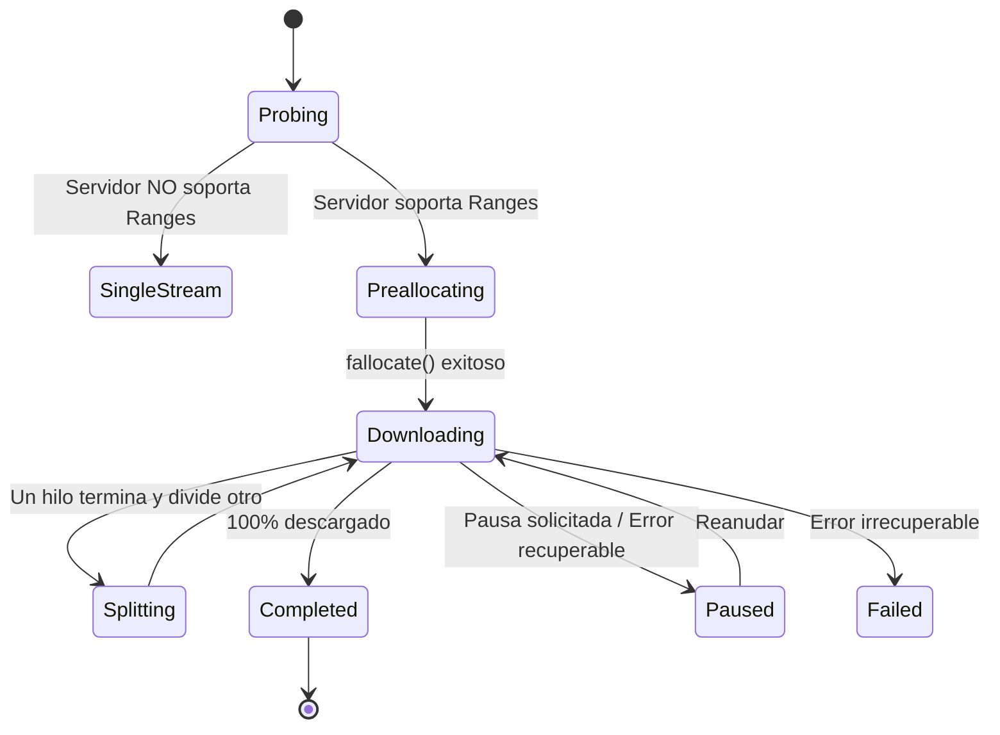

# OpenSpec 02: Motor de Descargas y Algoritmo de Segmentación Dinámica

> **Especificación:** OPENSPEC-SEGMENTA-002  
> **Versión:** 1.0.0  
> **Área:** Núcleo de Red, Planificación Concurrente y E/S de Archivos

> **Normativo:** el contrato HTTP está en [`06-http-contract.md`](06-http-contract.md); la
> definición de `next_offset`, el handoff seguro y el DDL están en
> [`08-persistence-recovery.md`](08-persistence-recovery.md).

---

## 1. Fases del Ciclo de Vida de una Descarga

Cada descarga procesada por el motor de Segmenta atraviesa una máquina de estados determinista:



---

## 2. Fase de Sondeo (*Probing*)

Antes de lanzar hilos concurrentes, el motor ejecuta una solicitud ligera de sondeo:

```http
GET /recurso.zip HTTP/1.1
Host: cdn.servidor.com
User-Agent: Mozilla/5.0 (X11; Ubuntu; Linux x86_64) ...
Range: bytes=0-1
Connection: keep-alive
```

### Reglas de Evaluación de Respuesta:
1. **Soporte de Rangos Confirmado (`206 Partial Content`)**:
   * Si la cabecera `Content-Range` está presente con formato `bytes 0-1/TOTAL_BYTES`:
     $$\text{total\_size} = \text{TOTAL\_BYTES}$$
     Se activa el modo de **Segmentación Dinámica Concurrente** con $N$ conexiones (predeterminado: 16).
2. **Servidor Estándar sin Soporte de Rangos (`200 OK`)**:
   * El servidor ignora la cabecera `Range`. El archivo no se puede particionar.
   * Se conmuta a **Single-Stream** (descarga secuencial tradicional con un solo hilo).
3. **Contenido Dinámico sin Tamaño (`Transfer-Encoding: chunked`)**:
   * No existe `Content-Length`. Se descarga en modo *streaming pipe* directamente a disco hasta el cierre de la conexión (`EOF`).

---

## 3. Algoritmo de Segmentación Dinámica en Caliente (*Dynamic Split*)

Este algoritmo es el pilar central de rendimiento de Segmenta y resuelve el problema de la desaceleración por conexiones estranguladas o hilos ociosos.

### 3.1. Partición Inicial
Dado un tamaño total $S$ y un número de conexiones objetivo $N$:
* Si $S < 5 \text{ MB}$, usar $N = 1$.
* Si $5 \text{ MB} \le S < 50 \text{ MB}$, usar $N = 4$.
* Si $S \ge 50 \text{ MB}$, usar $N = 16$ (o el valor configurado por el usuario, hasta 32).

Se calcula el tamaño base de cada segmento inicial:
$$\text{chunk\_size} = \left\lfloor \frac{S}{N} \right\rfloor$$

Para cada segmento $i \in [0, N-1]$:
$$\text{start\_offset}_i = i \times \text{chunk\_size}$$
$$\text{end\_offset}_i = \begin{cases} (i + 1) \times \text{chunk\_size} - 1 & \text{si } i < N - 1 \\ S - 1 & \text{si } i = N - 1 \end{cases}$$
$$\text{next\_offset}_i = \text{start\_offset}_i$$

---

### 3.2. Lógica de Fisión Dinámica (*Hot-Splitting*) y Protocolo Anti-Carrera

Cada hilo de trabajo (*worker*) reporta continuamente su `next_offset`. Para evitar condiciones de carrera donde bytes en vuelo desborden la nueva frontera, la división se ejecuta mediante el **Protocolo de Handoff Cooperativo** (especificado formalmente en `OpenSpec 08`):

1. **Evento de Disparo**: El worker $W_k$ finaliza la descarga de su segmento asignado $S_k$ ($\text{next\_offset}_k == \text{end\_offset}_k + 1$).
2. **Búsqueda de Donante**:
   * El planificador itera sobre todos los segmentos activos $\{S_j\}$ que están siendo descargados por otros workers.
   * Calcula los bytes restantes por descargar de cada uno:
     $$\text{restante}_j = (\text{end\_offset}_j - \text{next\_offset}_j) + 1$$
   * Selecciona el segmento con el mayor número de bytes restantes:
     $$S_{\text{max}} = \arg\max_j (\text{restante}_j)$$
3. **Umbral de Fisión**:
   * Definir constante $\text{MIN\_SPLIT\_SIZE} = 2 \text{ MB}$ ($2{,}097{,}152$ bytes).
   * **Condición:** Si $\text{restante}_{\text{max}} < \text{MIN\_SPLIT\_SIZE}$, **no dividir**. El worker $W_k$ entra en reposo (*idle*), ya que el coste de handshake TLS y latencia de conexión supera el beneficio de dividir una porción pequeña.
4. **Handoff Atómico y Clamp de Lectura (Ver OpenSpec 08):**
   * El planificador envía `SplitRequest { target_midpoint }` al worker donante.
   * El donante confirma con `SplitAck` y aplica un *hard-clamp* en su buffer de lectura para no leer más allá de `target_midpoint`.
   * Solo tras la confirmación del donante, se instancia el nuevo worker $W_k$ en el rango $[\text{target\_midpoint} + 1, \text{fin\_antiguo}_{\text{max}}]$.
5. **Reconexión Inmediata**:
   * El worker $W_k$ reutiliza el pool de conexiones o abre un nuevo socket TCP y envía:
     ```http
     GET /recurso.zip HTTP/1.1
     Host: cdn.servidor.com
     Range: bytes=[punto_medio + 1]-[fin_antiguo]
     ```

---

## 4. Subsistema de E/S de Disco (Sin Ensamblado)

A diferencia de Windows, donde cada conexión escribe en un archivo temporal separado y luego se copian secuencialmente, **Segmenta escribe directamente en el archivo destino**:

### 4.1. Preasignación con `posix_fallocate`
Al conocer el `total_size`:
```c
int fd = open(final_path, O_RDWR | O_CREAT | O_CLOEXEC, 0600);
if (fd < 0) {
    /* Manejar error de permisos o ruta */
}

// Reserva física garantizada de bloques en el sistema de archivos
int ret = posix_fallocate(fd, 0, total_size);
if (ret == ENOSPC) {
    // Espacio insuficiente: abortar antes de descargar.
} else if (ret == EOPNOTSUPP || ret == ENOSYS) {
    // Filesystem sin fallocate: ftruncate/set_len + fstatvfs, nunca fallar en silencio.
}
```
* **Ventaja:** Elimina la fragmentación del archivo en ext4/btrfs/xfs y asegura de antemano que el disco no se llenará a mitad del proceso. `posix_fallocate()` no está garantizado en todos los filesystems (ZFS/FUSE, por ejemplo); el fallback es `ftruncate`/`set_len` con comprobación de espacio con `fstatvfs`, no un fallo silencioso.

### 4.2. Escrituras Atómicas Desplazadas con `pwrite64`
Cada worker mantiene su propio búfer de lectura en memoria (ej. 64 KB o 128 KB). Al recibir un chunk desde el socket de red:

```c
// pwrite_all: repite hasta vaciar el buffer, maneja EINTR y escrituras parciales.
// No usa ni altera el puntero interno del descriptor.
int pwrite_all(int fd, const void *buf, size_t len, off_t offset);
```

* **Ventaja:** `pwrite64` no utiliza ni altera el puntero interno del descriptor (`lseek`). Los workers pueden escribir en rangos distintos sin un mutex de archivo. La atomicidad es **por syscall y por rango**: `pwrite64` puede escribir menos bytes, devolver `EINTR` o fallar; el motor debe usar `pwrite_all` (08) y no asumir que un solo `pwrite64` completa el buffer.
* **Persistencia:** `pwrite64` no vuelca los datos a disco. Antes de actualizar `next_offset` en SQLite, el checkpoint debe hacer `fdatasync` (o una política equivalente documentada) y sólo después confirmar la transacción; si no, un corte puede dejar la base apuntando a bytes que el filesystem perdió. El cierre final hace `fsync`, `close` y la transición atómica desde `temp_path` al `final_path` cuando corresponda.

---

## 5. Control de Flujo y Estrangulamiento de Velocidad

Para respetar la opción de "Límite de Velocidad Global":
* Se implementa el algoritmo **Token Bucket**:
  * Un cubo (*bucket*) recibe tokens a una tasa de $R$ bytes/segundo.
  * Antes de que cualquier worker lea datos de su socket, debe solicitar $B$ tokens del cubo global.
  * Si el cubo está vacío, el worker espera asíncronamente en el runtime (`tokio::time::sleep` en Rust o `time.Sleep` en Go) hasta la reposición de tokens.
