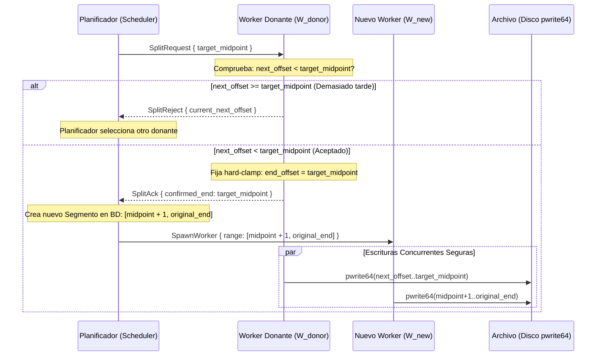

# OpenSpec 08: Persistencia, Resiliencia y Algoritmo Concurrente Seguro

> **Especificación:** OPENSPEC-SEGMENTA-008  
> **Versión:** 1.1.0  
> **Área:** Base de Datos Transaccional SQLite, Respaldo Criptográfico y Resolución de Carreras en Hot-Split

> **Alcance de esta revisión.** El árbol de código está en **0.1.2** y el esquema efectivo es
> **`PRAGMA user_version = 3`** (`segmenta_daemon::store::SCHEMA_VERSION`). El DDL de §4 es el
> que aplica hoy `crates/segmenta-daemon/src/schema.sql` más las migraciones encadenadas. Lo
> que pertenece a **0.2.0** se marca con **«(0.2, en preparación)»**: el esquema pasará a
> **v4** y esas columnas **no existen todavía**. Ningún lector debe asumir campos v4.

---

## 1. Definición Formal de Rangos e Invariantes Numéricos

### 1.1. Convención de Intervalos Cerrados
Todos los rangos de bytes en Segmenta se definen como **intervalos cerrados** $[A, B]$
coincidentes con la especificación de cabeceras HTTP (RFC 9110):
* `start_offset`: primer byte del intervalo (inclusivo).
* `end_offset`: último byte del intervalo (inclusivo).
* `next_offset`: desplazamiento del **próximo byte que se escribirá** en disco ($0$-indexed).

### 1.2. Invariantes Matemáticos Obligatorios
1. $\text{start\_offset} \le \text{next\_offset} \le \text{end\_offset} + 1$
2. $\text{bytes\_escritos} = \text{next\_offset} - \text{start\_offset}$
3. $\text{bytes\_restantes} = (\text{end\_offset} - \text{next\_offset}) + 1$
4. **Condición de finalización de segmento:**
   $\text{next\_offset} == \text{end\_offset} + 1$
5. Para dos segmentos adyacentes $S_i$ y $S_{i+1}$:
   $\text{end\_offset}_i + 1 == \text{start\_offset}_{i+1}$
   *(sin superposición de rangos y sin huecos de bytes).*

Los tres primeros invariantes están además en el `CHECK` de la tabla `segments` (§4.2), así
que una violación es un error de SQLite y no una fila silenciosamente corrupta.

---

## 2. Protocolo de División Segura (*Safe Hot-Split Handoff*)

### 2.1. El riesgo de condición de carrera
Si el planificador modifica `end_offset` de forma unilateral mientras el worker donante
$W_{\text{donante}}$ lee datos del socket, los bytes que ya están en vuelo en el buffer del
kernel o del runtime TCP se escribirían más allá del nuevo límite, corrompiendo la porción
asignada al nuevo worker.

### 2.2. Protocolo cooperativo en 5 pasos



### 2.3. Clamp estricto de lectura en el worker donante
El bucle de red del worker donante limita la lectura de bytes pendientes:

```rust
let bytes_to_read = std::cmp::min(
    buffer.len() as u64,
    (self.end_offset - self.next_offset) + 1,
) as usize;
```

Además, el worker **recorta el buffer ya lleno** antes de confirmar: los bytes leídos más
allá de `target_midpoint` se descartan y no se escriben. `SplitAck` sólo se envía cuando
`next_offset + buffer_len <= target_midpoint + 1`; si no se puede cumplir responde
`SplitReject` y el planificador elige otro donante. El nuevo worker no se lanza hasta recibir
el `SplitAck`. Un split aceptado se anuncia como evento `segment_split` (§07 §5.1).

---

## 3. Primitiva Atómica de Disco (`pwrite`)

`crates/segmenta-core/src/disk.rs` implementa dos capas sobre la misma rutina,
`pwrite_all_with`:

```rust
pub fn pwrite_all_with<F>(buf: &[u8], offset: u64, mut write: F) -> std::io::Result<()>
where
    F: FnMut(&[u8], u64) -> std::io::Result<usize>,
{
    let mut done = 0usize;
    while done < buf.len() {
        match write(&buf[done..], offset + done as u64) {
            Ok(0) => return Err(std::io::Error::new(
                std::io::ErrorKind::WriteZero, "pwrite returned 0 bytes")),
            Ok(n) => done += n,
            Err(err) if err.kind() == std::io::ErrorKind::Interrupted => continue,
            Err(err) => return Err(err),
        }
    }
    Ok(())
}
```

* `pwrite_all_fd(fd, buf, offset)`: variante sobre descriptor crudo con `libc::pwrite`; nunca
  lee ni mueve el cursor del descriptor.
* **Preasignación:** `posix_fallocate` reserva los bloques. `EOPNOTSUPP`/`ENOSYS`/`EINVAL`
  degradan a `set_len` con comprobación previa de espacio libre por `fstatvfs`;
  `ENOSPC` es terminal (`1006 DISK_FULL`).
* **Durabilidad:** `sync_data()`/`sync_all()` antes de publicar el checkpoint en SQLite
  (§6.1). Un reinicio por caché obsoleta usa `truncate()` (`set_len(0)` + `sync_all`).

---

## 4. Esquema de Base de Datos SQLite (normativo)

La persistencia se aloja en `$XDG_DATA_HOME/segmenta/segmenta.db`.

### 4.1. Configuración de conexión (pragmas obligatorios)
Al abrir cada conexión (`Store::open`):
```sql
PRAGMA journal_mode = WAL;
PRAGMA synchronous = NORMAL;
PRAGMA foreign_keys = ON;
PRAGMA busy_timeout = 5000;
PRAGMA wal_autocheckpoint = 1000;
```
Los permisos se fuerzan después de migrar: archivo `0600`
(`$XDG_DATA_HOME/segmenta` con `0700`).

### 4.2. DDL normativo — esquema vigente (v3)

El bloque siguiente es `crates/segmenta-daemon/src/schema.sql` **tal cual** (comentarios
incluidos), el script que `Store::migrate` aplica cuando `user_version < 1`. Ya contiene
`site_logins`, `torrents` y `torrent_files`, y el `CHECK` de `download_type` con los ocho
valores.

Una base nueva ejecuta además las dos reconstrucciones de 4.3, así que el resultado
efectivo **no es idéntico a `schema.sql`**: añade a `downloads` las cinco columnas de medios
y dos índices. Esos deltas están aislados en 4.2.1, no dentro del DDL de `schema.sql`.

```sql
-- Normative schema of OpenSpec 08 (DDL verbatim). Applied once inside a transaction
-- by Store::migrate; the schema version lives in PRAGMA user_version.

CREATE TABLE IF NOT EXISTS queues (
    name TEXT PRIMARY KEY,
    max_active INTEGER NOT NULL DEFAULT 1 CHECK(max_active BETWEEN 1 AND 8),
    created_at TIMESTAMP NOT NULL DEFAULT CURRENT_TIMESTAMP
);

INSERT OR IGNORE INTO queues(name, max_active) VALUES ('main', 3);

CREATE TABLE IF NOT EXISTS downloads (
    id TEXT PRIMARY KEY,
    url TEXT NOT NULL,
    final_url TEXT,
    final_path TEXT NOT NULL,
    temp_path TEXT,
    total_bytes INTEGER, -- NULL para transfer-encoding: chunked
    downloaded_bytes INTEGER NOT NULL DEFAULT 0,
    status TEXT NOT NULL CHECK(status IN (
        'pending', 'probing', 'downloading', 'paused',
        'retrying', 'verifying', 'finalizing',
        'completed', 'failed', 'cancelled'
    )),
    supports_ranges BOOLEAN NOT NULL DEFAULT 0,
    etag TEXT,
    last_modified TEXT,
    content_type TEXT,
    expected_checksum TEXT,
    error_code INTEGER,
    error_message TEXT,
    retry_count INTEGER NOT NULL DEFAULT 0,
    priority INTEGER NOT NULL DEFAULT 0,
    queue_name TEXT NOT NULL DEFAULT 'main' REFERENCES queues(name),
    download_type TEXT NOT NULL DEFAULT 'direct' CHECK(download_type IN ('direct', 'hls', 'dash', 'youtube_video', 'youtube_playlist', 'youtube_audio', 'torrent', 'magnet')),
    created_at TIMESTAMP DEFAULT CURRENT_TIMESTAMP,
    completed_at TIMESTAMP
);

CREATE TABLE IF NOT EXISTS download_headers (
    download_id TEXT PRIMARY KEY,
    -- Sólo cabeceras no sensibles (User-Agent, Referer, Accept, etc.).
    headers_json TEXT NOT NULL DEFAULT '{}',
    FOREIGN KEY(download_id) REFERENCES downloads(id) ON DELETE CASCADE
);

CREATE TABLE IF NOT EXISTS download_secrets (
    download_id TEXT PRIMARY KEY,
    -- Alias/ID del secreto en GNOME Keyring; contiene Authorization y cookies.
    keyring_secret_id TEXT NOT NULL,
    FOREIGN KEY(download_id) REFERENCES downloads(id) ON DELETE CASCADE
);

CREATE TABLE IF NOT EXISTS segments (
    id INTEGER PRIMARY KEY AUTOINCREMENT,
    download_id TEXT NOT NULL,
    start_offset INTEGER NOT NULL,
    end_offset INTEGER NOT NULL,
    next_offset INTEGER NOT NULL,
    status TEXT NOT NULL CHECK(status IN ('idle', 'active', 'completed', 'failed')),
    CHECK(start_offset >= 0),
    CHECK(end_offset >= start_offset),
    CHECK(next_offset >= start_offset AND next_offset <= end_offset + 1),
    UNIQUE(download_id, start_offset),
    FOREIGN KEY(download_id) REFERENCES downloads(id) ON DELETE CASCADE
);

CREATE TABLE IF NOT EXISTS download_stream_plan (
    download_id TEXT PRIMARY KEY,
    manifest_url TEXT NOT NULL,
    stream_kind TEXT NOT NULL CHECK(stream_kind IN ('hls', 'dash')),
    selected_variant TEXT NOT NULL,
    init_video_url TEXT,
    init_audio_url TEXT,
    media_sequence INTEGER NOT NULL DEFAULT 0,
    fragments_json TEXT NOT NULL,
    FOREIGN KEY(download_id) REFERENCES downloads(id) ON DELETE CASCADE
);

CREATE TABLE IF NOT EXISTS settings (
    key TEXT PRIMARY KEY,
    value_json TEXT NOT NULL
);

CREATE TABLE IF NOT EXISTS site_logins (
    domain TEXT PRIMARY KEY,
    username TEXT NOT NULL,
    keyring_secret_id TEXT NOT NULL
);

CREATE TABLE IF NOT EXISTS torrents (
    download_id TEXT PRIMARY KEY,
    info_hash TEXT NOT NULL UNIQUE,
    source TEXT NOT NULL,
    seed_after_complete BOOLEAN NOT NULL DEFAULT 0,
    uploaded_bytes INTEGER NOT NULL DEFAULT 0,
    peers INTEGER NOT NULL DEFAULT 0,
    files_count INTEGER NOT NULL DEFAULT 0,
    FOREIGN KEY(download_id) REFERENCES downloads(id) ON DELETE CASCADE
);

CREATE TABLE IF NOT EXISTS torrent_files (
    download_id TEXT NOT NULL,
    file_index INTEGER NOT NULL,
    path TEXT NOT NULL,
    length INTEGER NOT NULL,
    selected BOOLEAN NOT NULL DEFAULT 1,
    PRIMARY KEY(download_id, file_index),
    FOREIGN KEY(download_id) REFERENCES downloads(id) ON DELETE CASCADE
);

-- Índices para consultas de alta velocidad en la GUI
CREATE INDEX IF NOT EXISTS idx_downloads_status ON downloads(status);
CREATE INDEX IF NOT EXISTS idx_downloads_queue ON downloads(queue_name, priority DESC);
CREATE INDEX IF NOT EXISTS idx_segments_download_id ON segments(download_id);
CREATE INDEX IF NOT EXISTS idx_downloads_created_at ON downloads(created_at DESC);
```

#### 4.2.1. Deltas que añaden las migraciones v2 y v3

Ni las columnas de medios ni estos dos índices están en `schema.sql`: los crea la
reconstrucción de `downloads`. En una base nueva también se aplican, así que forman parte
del esquema efectivo v3.

```sql
-- Añadidas a `downloads` por la reconstrucción v2 (y conservadas por la v3):
    media_kind TEXT,
    media_format TEXT,
    playlist_title TEXT,
    playlist_count INTEGER,
    batch_id TEXT

-- Índices creados por las migraciones (no están en schema.sql):
CREATE INDEX IF NOT EXISTS idx_downloads_batch ON downloads(batch_id);              -- v2
CREATE INDEX IF NOT EXISTS idx_torrent_files_download ON torrent_files(download_id); -- v3
```

Notas del esquema vigente:

* `idx_downloads_batch` lo crea la migración v2 e `idx_torrent_files_download` la v3; en una
  base nueva existen porque las migraciones corren igual sobre la base recién creada.
* `settings` guarda los ajustes de §07 §3.10.1 **y** las ventanas horarias por cola bajo la
  clave `queue_schedule:<nombre>`. Esas filas no las devuelve `settings.get`.
* `site_logins` existe desde v1 (está en `schema.sql`), pero **ningún código la lee ni la
  escribe**: los RPC `site_login.*` son **(0.2, en preparación)** (§07 §3.12 y el nuevo
  OpenSpec 12).
* `torrents` y `torrent_files` existen desde v1 en `schema.sql` y desde v3 en las bases
  migradas, y **sí** se escriben hoy (`store::insert_torrent`,
  `store::insert_torrent_file`): una fila por tarea y una única fila `torrent_files` con
  índice `0` (§07 §3.8).
* `queues.max_active` admite 1–8 por `CHECK`; `store::create_queue` valida además el nombre
  (1–64 caracteres `[a-z0-9_-]`). Hoy `max_active` no limita el arranque de tareas: es un
  dato persistido a la espera del scheduler de 0.2.

#### 4.2.2. Columnas planificadas de v4 — (0.2, en preparación)

**No existen todavía.** Cuando se implemente A2, la migración v4 agregará a `downloads`
`quarantine_path`, `postprocess_exit` y `postprocess_message` con `ALTER TABLE ... ADD
COLUMN` (tipos propuestos `TEXT`, `INTEGER`, `TEXT`) y subirá `SCHEMA_VERSION` a 4.
`torrents`, `torrent_files` y `site_logins` **no** son parte de v4: ya existen en el esquema
vigente (4.2 y 4.2.1).

### 4.3. Cadena de migraciones

`Store::migrate` lee `PRAGMA user_version`, aplica todo lo pendiente dentro de **una**
transacción y escribe `user_version` una sola vez al final. Si `user_version >=
SCHEMA_VERSION` no hace nada.

| Versión | Implementación | Contenido | Estado |
| --- | --- | --- | --- |
| **v1** | `schema.sql` (`current < 1`) | Tablas base: `queues` (+ fila `main` con `max_active = 3`), `downloads` (todavía **sin** las columnas de medios), `download_headers`, `download_secrets`, `segments`, `download_stream_plan`, `settings`, `site_logins`, `torrents`, `torrent_files` e índices de `downloads`/`segments`. El `CHECK` de `download_type` de este script ya lleva los ocho valores (`torrent` y `magnet` incluidos), no los tres históricos de 0.0.x. | **Implementado** |
| **v2** | `MEDIA_REBUILD_SQL` (`current < 2`) | SQLite no puede alterar un `CHECK`, así que se reconstruye `downloads`: se amplía `download_type` con `youtube_video`, `youtube_playlist` y `youtube_audio`, se agregan `media_kind`, `media_format`, `playlist_title`, `playlist_count`, `batch_id` y se crea `idx_downloads_batch`. `PRAGMA foreign_keys` se desactiva durante el intercambio (`downloads_v2` → `DROP` → `RENAME`) y se reactiva al terminar. | **Implementado** |
| **v3** | `TORRENT_REBUILD_SQL` (`current < 3`) | Segunda reconstrucción de `downloads` para ampliar `download_type` con `torrent` y `magnet`; crea `torrents`, `torrent_files` e `idx_torrent_files_download`. Mismo intercambio con claves foráneas desactivadas. `SCHEMA_VERSION = 3`. | **Implementado** |
| **v4** | *(pendiente)* | Agregar a `downloads` las columnas de post-proceso y cuarentena y subir `SCHEMA_VERSION` a **4**. Columnas acordadas: `quarantine_path`, `postprocess_exit`, `postprocess_message`. Los tipos definitivos los fija la migración cuando se implemente; la propuesta es `TEXT`, `INTEGER` y `TEXT`. `ALTER TABLE ... ADD COLUMN` es suficiente: no hay `CHECK` nuevo que forzar. Ninguna columna v4 existe hoy. | **(0.2, en preparación)** |

Consecuencias de esta cadena, tal como está implementada:

* Una base v1 salta a v3 en la misma transacción aplicando v2 y v3 en orden; no hay ruta
  «sólo v2» que se quede a medias, porque ambas se ejecutan con `current` leído al principio.
* Una base nueva (`current == 0`) ejecuta `schema.sql` y **también** los dos rebuilds. El
  resultado no es idéntico a `schema.sql`: los rebuilds agregan las cinco columnas de medios
  (`media_kind`, `media_format`, `playlist_title`, `playlist_count`, `batch_id`) y los
  índices `idx_downloads_batch` e `idx_torrent_files_download` (4.2.1). Cualquier lector debe
  usar el resultado de la cadena, no el contenido literal de `schema.sql`, como esquema
  efectivo.
* El `CHECK` de `download_type` que deja v2 es más estrecho que el de v1 (`torrent` y
  `magnet` fuera) y v3 lo vuelve a ampliar. Es inofensivo porque ninguna de las dos
  reconstrucciones ve filas torrent: `schema.sql`, v2 y v3 corren en la misma transacción.
* Los rebuilds no copian `downloads_v2`/`downloads_v3` como respaldo: si la transacción
  falla, SQLite revierte y la base queda como estaba.
* `downloads` no tiene índice único sobre `final_path`: dos tareas concurrentes pueden
  apuntar a la misma ruta sugerida. `resolve_unique_path` es una sugerencia, no una reserva
  (§4.4).

### 4.4. Colisiones y finalización
* **Política real: `suffix`.** `segmenta_core::filename::resolve_unique_path` devuelve
  `archivo (1).ext`, `archivo (2).ext`, … hasta `MAX_COLLISION_ATTEMPTS`; al agotarse
  devuelve `AlreadyExists`, que el daemon reporta como `1005
  ERR_DESTINATION_UNWRITABLE`. **No** existen los modos `ask` ni `overwrite`: sobrescribir
  nunca es el comportamiento por defecto.
* La ruta se elige antes de crear la tarea y se persiste en `final_path`. La carrera entre
  dos tareas con el mismo nombre queda fuera del alcance inmediato; el comentario de
  `resolve_unique_path` ya advierte que es una sugerencia.
* **`temp_path` no se usa hoy:** la columna existe y siempre vale `NULL`. El motor escribe
  directamente en `final_path` (preasignado con `fallocate`/`set_len`) y publica el archivo
  con `sync`; no hay renombrado atómico desde un temporal. Un archivo parcial nunca se marca
  `completed`, pero sí ocupa su ruta final mientras la tarea avanza.
* `posix_fallocate` con `EOPNOTSUPP`/`ENOSYS` degrada a `ftruncate`/`set_len` tras comprobar
  el espacio con `fstatvfs`; `ENOSPC` es terminal (`1006`).

---

## 5. Almacenamiento Seguro de Credenciales y Privacidad

1. **Permisos del archivo de base de datos:** `0600`; el directorio
   `$XDG_DATA_HOME/segmenta`, `0700`.
2. **Contraseñas y tokens nunca en SQLite.** `crates/segmenta-daemon/src/secrets.rs`
   implementa dos backends de `SecretStore`:
   * `KeyringSecretStore` — habla con el Secret Service a través de `secret-tool` (libsecret).
     Disponibilidad: `secret-tool lookup service segmenta key __segmenta_probe__` debe salir
     con código `0` (secreto encontrado) o `1` (no hay secreto); `secret-tool --version`
     **no** se usa, porque en libsecret 0.21 devuelve `2`. `SEGMENTA_SECRET_TOOL` permite
     apuntar a otro binario (tests). `system.status` lo reporta como `secret_backend:
     "keyring"`.
   * `UnavailableSecretStore` — cuando no hay keyring. `store()` falla con
     `SecretError::Unavailable`, `lookup()` devuelve `None` y `delete()` es un no-op.
     `system.status` lo reporta como `"unavailable"`.
   * `FileSecretStore` (archivo JSON `0600` junto a la base de datos) **no se selecciona
     automáticamente**; sólo se usa para importar el archivo `secrets.json` heredado de
     0.0.1 al keyring (`migrate_legacy_file`). Si la importación falla a medias, el archivo
     se conserva para un intento posterior.
3. **SQLite sólo guarda el alias.** `download_secrets.keyring_secret_id` apunta al secreto de
   la tarea (alias `download/<task_id>`) y `site_logins.keyring_secret_id` al del sitio
   (alias previsto `site/<domain>`, **(0.2, en preparación)**).
4. **Ciclo de vida de los secretos de tarea, tal como está implementado:**
   * `download.add` escribe el secreto **antes** de insertar la fila: si el backend no está
     disponible responde `1031 ERR_KEYRING_UNAVAILABLE` y **no** crea la tarea. No hay tarea
     `paused` por falta de llavero.
   * `download.cancel` y `download.delete` borran el secreto del backend (y el alias de la
     tabla por cascada o por borrado de la fila).
   * Una tarea `completed` **conserva** su secreto: hoy no existe limpieza al completar.
5. **Nunca se registran secretos:** ni en el log (`logging::sanitize_url` recorta query
   strings), ni en eventos, ni en `settings.get`.

---

## 6. Recuperación ante Cortes Eléctricos (*Crash Recovery*)

### 6.1. Frecuencia y orden de flush
* Cada worker actualiza su `next_offset` de forma agrupada: **cada 2 segundos**
  (`CHECKPOINT_INTERVAL`) o **cada 5 MiB** (`CHECKPOINT_BYTES`), lo que ocurra primero; al
  terminar, antes de publicar el estado terminal.
* El orden es obligatorio: `pwrite` → `sync_data`/`sync_all` del archivo → transacción
  SQLite (`Store::save_checkpoint`). La base nunca queda adelantada respecto de los bytes
  que el filesystem confirmó; si queda atrasada se reescriben bytes ya presentes
  (idempotente) y nunca se saltan bytes.
* `supports_ranges` se copia del probe, no se asume: una tarea `chunked` jamás se marca
  reanudable.

### 6.2. Procedimiento de arranque tras una caída
Al iniciar, `Manager::recover` llama a `Store::recover_crashed`, que en una sola pasada:

```sql
SELECT id FROM downloads WHERE status IN
    ('downloading', 'probing', 'verifying', 'finalizing', 'retrying');
UPDATE downloads SET status = 'paused' WHERE status IN
    ('downloading', 'probing', 'verifying', 'finalizing', 'retrying');
```

Cada id afectado emite `state_changed` con `new_state: "paused"` y `reason:
"daemon_restart"`; `old_state` se escribe **literalmente** como `"downloading"` para todos
los casos, aunque el estado previo real fuese `probing`, `retrying`, `verifying` o
`finalizing`. Las tareas `pending` **no** se tocan.

### 6.3. Reanudación
Al recibir `download.resume`, cada worker lee su último `next_offset` y emite
`Range: bytes={next_offset}-{end_offset}` con `If-Range: {etag}`/`{last_modified}` cuando
existe validador. Si el servidor responde `200` a una reanudación, o cambia el total, el
motor trunca el archivo, reinicia los segmentos desde cero y emite
`download_restarted_due_to_stale_cache` con `reason` (`06` §2.2).

Si no hay nada checkpointeado (`build_resume` devuelve `None`), `start_task` **borra** el
archivo existente en `final_path` antes de arrancar: los bytes en disco no están
verificados y no se pueden reutilizar.
