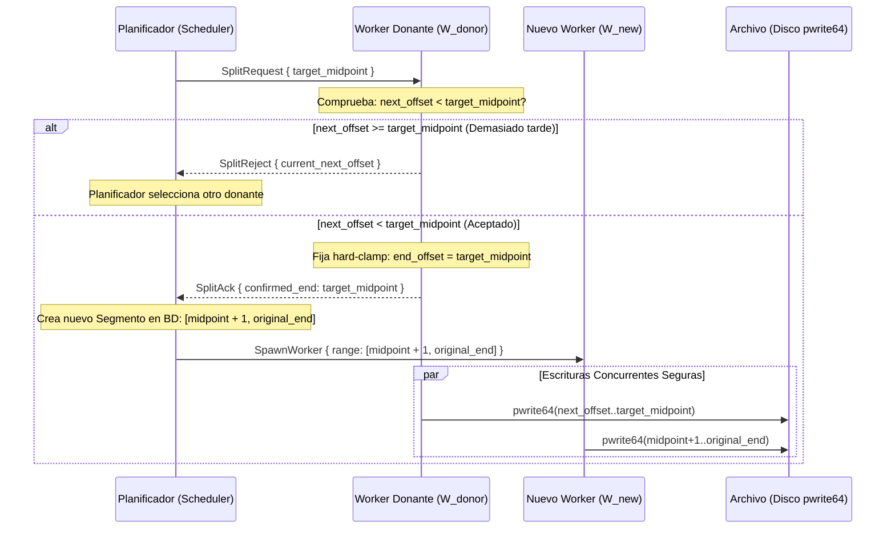

# OpenSpec 08: Persistencia, Resiliencia y Algoritmo Concurrente Seguro

> **Especificación:** OPENSPEC-SEGMENTA-008  
> **Versión:** 1.0.0  
> **Área:** Base de Datos Transaccional SQLite, Respaldo Criptográfico y Resolución de Carreras en Hot-Split

---

## 1. Definición Formal de Rangos e Invariantes Numéricos

Para erradicar errores de tipo *off-by-one* en la partición y ensamblado de archivos:

### 1.1. Convención de Intervalos Cerrados
Todos los rangos de bytes en Segmenta se definen como **intervalos cerrados** $[A, B]$ coincidentes con la especificación de cabeceras HTTP (RFC 9110):
* `start_offset`: Primer byte del intervalo (inclusivo).
* `end_offset`: Último byte del intervalo (inclusivo).
* `next_offset`: Desplazamiento del **próximo byte que se escribirá** en disco ($0$-indexed).

### 1.2. Invariantes Matemáticos Obligatorios
1. $\text{start\_offset} \le \text{next\_offset} \le \text{end\_offset} + 1$
2. $\text{bytes\_escritos} = \text{next\_offset} - \text{start\_offset}$
3. $\text{bytes\_restantes} = (\text{end\_offset} - \text{next\_offset}) + 1$
4. **Condición de Finalización de Segmento:**
   $$\text{next\_offset} == \text{end\_offset} + 1$$
5. Para dos segmentos adyacentes $S_i$ y $S_{i+1}$:
   $$\text{end\_offset}_i + 1 == \text{start\_offset}_{i+1}$$
   *(Queda estrictamente prohibida cualquier superposición de rangos o hueco de bytes no cubierto).*

---

## 2. Protocolo de División Segura (*Safe Hot-Split Handoff*)

### 2.1. El Riesgo de Condición de Carrera
Si el planificador modifica `end_offset` de forma unilateral mientras el worker donante $W_{\text{donante}}$ lee datos del socket de red, los bytes que ya están en vuelo en el buffer del kernel o del runtime TCP se escribirán más allá del nuevo límite, corrompiendo la porción asignada al nuevo worker.

### 2.2. Protocolo Cooperativo en 5 Pasos
Para garantizar la atomicidad de la división:



### 2.3. Clamp Estricto de Lectura en el Worker Donante
El bucle de red del worker donante limita la lectura de bytes pendientes:
```rust
let bytes_to_read = std::cmp::min(
    buffer.len() as u64,
    (self.end_offset - self.next_offset) + 1
) as usize;
```
Esto garantiza matemáticamente que $W_{\text{donante}}$ jamás consumirá ni un solo byte del rango concedido al nuevo worker.

Además, el worker debe **recortar el buffer ya lleno** antes de confirmar: los bytes que haya leído
más allá de `target_midpoint` se descartan y no se escriben. `SplitAck` sólo se envía cuando
`next_offset + buffer_len <= target_midpoint + 1`; si no se puede cumplir, responde `SplitReject` y el
planificador elige otro donante. El nuevo worker no se lanza hasta recibir el `SplitAck`.

---

## 3. Primitiva Atómica de Disco (`pwrite_all`)

En sistemas POSIX, las llamadas a `pwrite64` pueden escribir menos bytes de los solicitados (*partial write*) o interrumpirse por señales del sistema (`EINTR`). Segmenta implementa una rutina de escritura garantizada:

```rust
use std::fs::File;
use std::io::{self, Error, ErrorKind};
use std::os::unix::fs::FileExt;

pub fn pwrite_all(file: &File, mut buf: &[u8], mut offset: u64) -> io::Result<()> {
    while !buf.is_empty() {
        match file.write_at(buf, offset) {
            Ok(0) => return Err(Error::new(ErrorKind::WriteZero, "pwrite devolvió 0 bytes")),
            Ok(n) => {
                buf = &buf[n..];
                offset += n as u64;
            }
            Err(ref e) if e.kind() == ErrorKind::Interrupted => continue,
            Err(e) => return Err(e),
        }
    }
    Ok(())
}
```

---

## 4. Esquema Completo de Base de Datos SQLite (v1.0.0)

La persistencia se aloja en `$XDG_DATA_HOME/segmenta/segmenta.db`.

### 4.1. Configuración de Conexión (Pragmas Obligatorios)
Al abrir cada conexión con SQLite:
```sql
PRAGMA journal_mode = WAL;
PRAGMA synchronous = NORMAL;
PRAGMA foreign_keys = ON;
PRAGMA busy_timeout = 5000;
PRAGMA wal_autocheckpoint = 1000;
```

### 4.2. Definición DDL de Tablas e Índices
```sql
-- Versión del esquema
PRAGMA user_version = 1;

CREATE TABLE IF NOT EXISTS queues (
    name TEXT PRIMARY KEY,
    max_active INTEGER NOT NULL DEFAULT 1 CHECK(max_active BETWEEN 1 AND 8),
    created_at TIMESTAMP NOT NULL DEFAULT CURRENT_TIMESTAMP
);

INSERT OR IGNORE INTO queues(name, max_active) VALUES ('main', 3);

CREATE TABLE IF NOT EXISTS downloads (
    id TEXT PRIMARY KEY,
    url TEXT NOT NULL,
    final_url TEXT,
    final_path TEXT NOT NULL,
    temp_path TEXT,
    total_bytes INTEGER, -- NULL para transfer-encoding: chunked
    downloaded_bytes INTEGER NOT NULL DEFAULT 0,
    status TEXT NOT NULL CHECK(status IN (
        'pending', 'probing', 'downloading', 'paused', 
        'retrying', 'verifying', 'finalizing', 
        'completed', 'failed', 'cancelled'
    )),
    supports_ranges BOOLEAN NOT NULL DEFAULT 0,
    etag TEXT,
    last_modified TEXT,
    content_type TEXT,
    expected_checksum TEXT,
    error_code INTEGER,
    error_message TEXT,
    retry_count INTEGER NOT NULL DEFAULT 0,
    priority INTEGER NOT NULL DEFAULT 0,
    queue_name TEXT NOT NULL DEFAULT 'main' REFERENCES queues(name),
    download_type TEXT NOT NULL DEFAULT 'direct' CHECK(download_type IN ('direct', 'hls', 'dash')),
    created_at TIMESTAMP DEFAULT CURRENT_TIMESTAMP,
    completed_at TIMESTAMP
);

CREATE TABLE IF NOT EXISTS download_headers (
    download_id TEXT PRIMARY KEY,
    -- Sólo cabeceras no sensibles (User-Agent, Referer, Accept, etc.).
    headers_json TEXT NOT NULL DEFAULT '{}',
    FOREIGN KEY(download_id) REFERENCES downloads(id) ON DELETE CASCADE
);

CREATE TABLE IF NOT EXISTS download_secrets (
    download_id TEXT PRIMARY KEY,
    -- Alias/ID del secreto en GNOME Keyring; contiene Authorization y cookies.
    keyring_secret_id TEXT NOT NULL,
    FOREIGN KEY(download_id) REFERENCES downloads(id) ON DELETE CASCADE
);

CREATE TABLE IF NOT EXISTS segments (
    id INTEGER PRIMARY KEY AUTOINCREMENT,
    download_id TEXT NOT NULL,
    start_offset INTEGER NOT NULL,
    end_offset INTEGER NOT NULL,
    next_offset INTEGER NOT NULL,
    status TEXT NOT NULL CHECK(status IN ('idle', 'active', 'completed', 'failed')),
    CHECK(start_offset >= 0),
    CHECK(end_offset >= start_offset),
    CHECK(next_offset >= start_offset AND next_offset <= end_offset + 1),
    UNIQUE(download_id, start_offset),
    FOREIGN KEY(download_id) REFERENCES downloads(id) ON DELETE CASCADE
);

CREATE TABLE IF NOT EXISTS download_stream_plan (
    download_id TEXT PRIMARY KEY,
    manifest_url TEXT NOT NULL,
    stream_kind TEXT NOT NULL CHECK(stream_kind IN ('hls', 'dash')),
    selected_variant TEXT NOT NULL,
    init_video_url TEXT,
    init_audio_url TEXT,
    media_sequence INTEGER NOT NULL DEFAULT 0,
    fragments_json TEXT NOT NULL,
    FOREIGN KEY(download_id) REFERENCES downloads(id) ON DELETE CASCADE
);

CREATE TABLE IF NOT EXISTS settings (
    key TEXT PRIMARY KEY,
    value_json TEXT NOT NULL
);

CREATE TABLE IF NOT EXISTS site_logins (
    domain TEXT PRIMARY KEY,
    username TEXT NOT NULL,
    keyring_secret_id TEXT NOT NULL
);

-- Índices para consultas de alta velocidad en la GUI
CREATE INDEX IF NOT EXISTS idx_downloads_status ON downloads(status);
CREATE INDEX IF NOT EXISTS idx_downloads_queue ON downloads(queue_name, priority DESC);
CREATE INDEX IF NOT EXISTS idx_segments_download_id ON segments(download_id);
CREATE INDEX IF NOT EXISTS idx_downloads_created_at ON downloads(created_at DESC);
```

### 4.3. Migraciones, colisiones y finalización
* `PRAGMA user_version` es la versión del esquema. Cada cambio futuro se entrega como migración
  idempotente en `crates/segmenta-daemon/migrations/` y se aplica dentro de una transacción; no se
  modifica una base existente a mano.
* El archivo de base de datos se crea con permisos `0600`; el directorio `$XDG_DATA_HOME/segmenta` con `0700`.
* `final_path` no se sobrescribe silenciosamente. Si existe, se aplica la política de colisión:
  `ask`, `suffix` (por defecto, `archivo (1).ext`) o `overwrite` si el usuario lo autorizó.
* `temp_path` es opcional: se usa para escribir y renombrar de forma atómica en la finalización. Si no se
  usa, el archivo final ya está preasignado y sólo se hace `fsync` + `close` al terminar. En ningún caso
  se publica un archivo parcial como completo.
* Si `posix_fallocate` devuelve `EOPNOTSUPP`/`ENOSYS`, se usa `ftruncate`/`set_len` y se comprueba el
  espacio con `fstatvfs`; `ENOSPC` es terminal.

---

## 5. Almacenamiento Seguro de Credenciales y Privacidad

1. **Permisos del Archivo de Base de Datos:**
   * Al crearse `$XDG_DATA_HOME/segmenta/segmenta.db`, sus permisos se fuerzan a **`0600`** (`-rw-------`).
2. **Contraseñas y Tokens Sensibles:**
   * Las contraseñas para autenticación en servidores **NUNCA se guardan en texto claro en SQLite**.
   * Se almacenan en el servicio seguro de contraseñas de GNOME mediante **`libsecret`** (D-Bus `org.freedesktop.secrets`). En la tabla `site_logins` solo se guarda el identificador o alias del secreto en el llavero del sistema.
3. **Cookies y Authorization de la tarea:**
   * `download_headers` guarda sólo las cabeceras no sensibles. `Authorization` y las cookies se guardan
     en el llavero y se referencian desde `download_secrets.keyring_secret_id`.
   * Las cookies se eliminan automáticamente cuando la descarga transiciona a `completed`, `cancelled` o
     `deleted`; al pausar se conservan para poder reanudar.
4. **Fallo del llavero:**
   * Si GNOME Keyring está bloqueado o no disponible, las tareas que necesitan credenciales quedan
     `paused` con `ERR_KEYRING_UNAVAILABLE`. Nunca se cae a SQLite en texto claro.

---

## 6. Recuperación ante Cortes Eléctricos (*Crash Recovery*)

1. **Frecuencia y orden de Flush:**
   * Cada worker actualiza su `next_offset` en SQLite de forma agrupada: **cada 2 segundos o cada 5 MB descargados**, lo que ocurra primero.
   * El orden es obligatorio: `pwrite_all` → `fdatasync`/checkpoint de datos → transacción SQLite. La base
     nunca debe quedar adelantada respecto de los bytes que el filesystem confirmó; si queda atrasada, se
     reescriben bytes ya presentes (idempotente), nunca se saltan bytes.
2. **Procedimiento de Arranque Tras una Caída:**
   * Al iniciar `segmenta-daemon`, ejecuta una consulta de reconciliación:
     ```sql
     UPDATE downloads 
     SET status = 'paused' 
     WHERE status IN ('downloading', 'probing', 'verifying', 'finalizing');
     ```
   * Como el archivo final ya estaba preasignado en disco con `fallocate`, su tamaño físico es consistente.
   * Al reanudar, cada worker consulta su último `next_offset` registrado y emite `Range: bytes={next_offset}-{end_offset}` con `If-Range: {etag}`. La descarga se reanuda de forma inmediata sin corromper datos.
