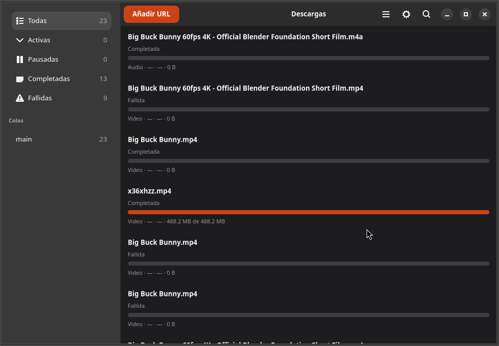
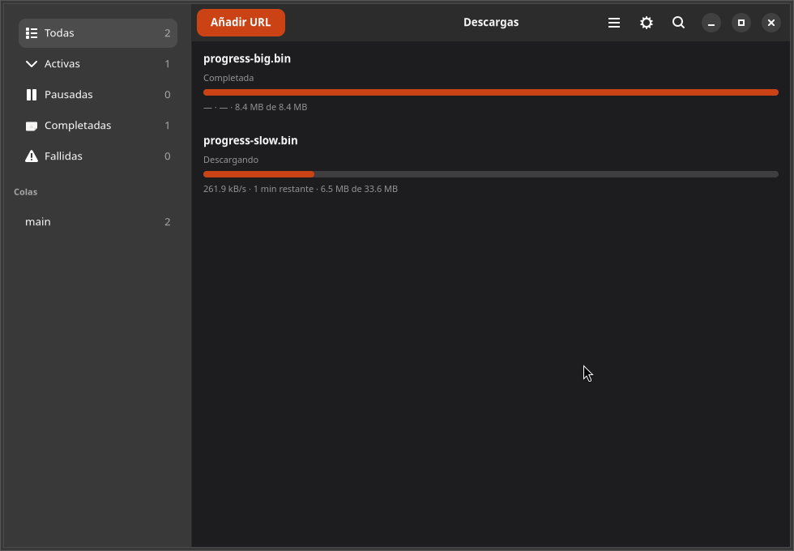
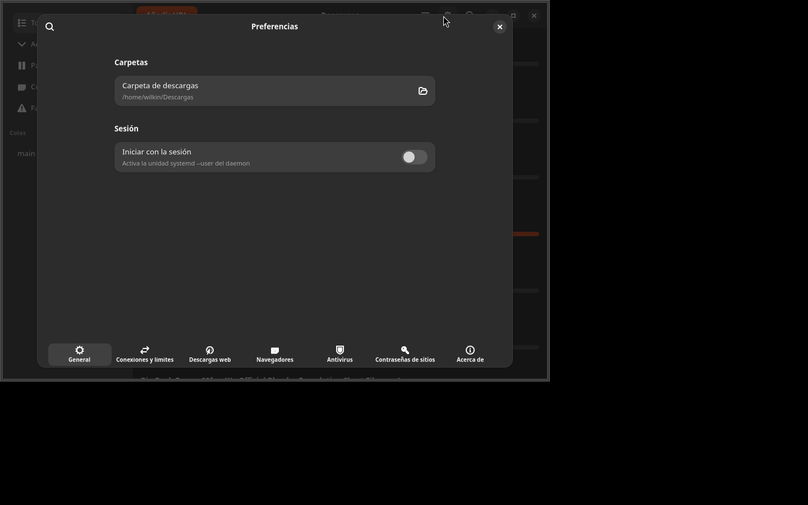
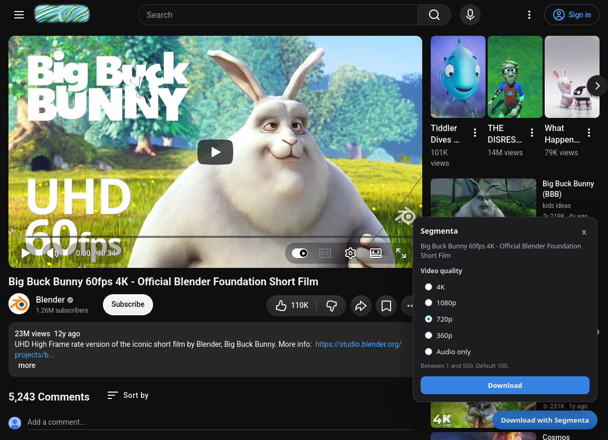
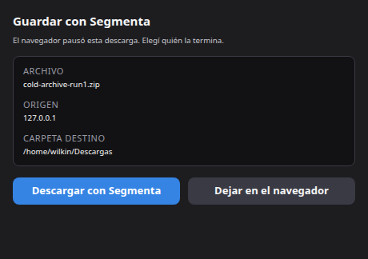

<p align="center">
  
</p>

# Segmenta 0.2.1

Descargas que sobreviven al navegador, a la red y al reinicio del equipo. Esta release cierra la
remediación de interfaz, la captura de iCloud, el progreso real de los medios y la gestión segura
del historial de descargas.



## Qué problema resuelve

Una descarga larga no debería depender de una pestaña abierta. Segmenta mantiene el estado en
SQLite, escribe los bytes en su offset final y sigue trabajando aunque cierres la GUI. La extensión
del navegador pausa la descarga antes de adoptarla, la CLI permite automatizar todo y el daemon
comparte la misma cola entre HTTP, torrents, YouTube y HLS/DASH.

## Flujo de trabajo

1. Instalá el `.deb` y habilitá `segmenta.socket`.
2. Añadí una URL desde la GUI, la CLI o la extensión.
3. La extensión pausa la descarga del navegador y muestra nombre, host y carpeta; aceptar crea la
   tarea en Segmenta.
4. Seguí porcentaje, velocidad, ETA y segmentos. La tarea más reciente queda arriba.
5. Pausá, reanudá o cambiá de cola sin perder bytes.
6. Al terminar, Segmenta verifica tamaño/checksum y ejecuta post-proceso y antivirus opcional.

## Capturas

### Lista y progreso



### Preferencias



### Extensión de YouTube



### Confirmación de captura



## Instalación

```bash
sha256sum -c segmenta_0.2.1-SHA256SUMS
sudo apt install ./segmenta_0.2.1-1_amd64.deb
systemctl --user daemon-reload
systemctl --user enable --now segmenta.socket
segmenta hello
```

El paquete instala `ffmpeg`, GTK4, libadwaita, libsecret-tools, `python3`, `ca-certificates` y
`yt-dlp`; además embebe `yt-dlp` 2026.10.26 porque el paquete de Ubuntu 26.04 es anterior al mínimo
de YouTube.

La extensión se carga manualmente desde `chrome://extensions` o `about:debugging`; después de
actualizar desde una versión anterior, pulsá **Recargar** en Segmenta.

## Cambios de esta release

### Interfaz

- Preferencias recupera sus siete páginas, incluida **Antivirus**, y abre a 960×760 sin títulos
  verticales ni controles recortados.
- Se eliminó el spinner persistente y el cursor de espera sobre la lista.
- Navegadores usa títulos horizontales, botones compactos y descripciones con wrap.
- Inset inferior y búsqueda retirada del diálogo para que el contenido no quede detrás de la barra
  de pestañas.

### Lista y progreso

- La lista conserva `created_at DESC`: la descarga más reciente queda arriba.
- La barra avanza con cada `task_progress`; `yt-dlp` 2026.10.26 emite el template sin el prefijo
  `download:` y el parser ya acepta la forma real.
- HLS/DASH o torrents sin tamaño conocido usan un pulso indeterminado con bytes reales.
- iCloud: se acepta el `200` con `Content-Range` de rango completo que devuelve Apple, en lugar de
  reiniciar y fallar con `1028`.
- Si un PDF pequeño termina antes de la pausa, la extensión avisa y permite añadir la URL a
  Segmenta; no queda un bypass silencioso.

### Gestión segura de descargas

- **Limpiar completadas** borra sólo filas `completed` y no toca archivos.
- **Eliminar seleccionadas** permite una o varias tareas, con confirmación, cantidad de archivos y
  casilla **Eliminar también los archivos descargados** desmarcada por defecto.
- Una tarea activa se detiene antes de tocar el archivo; los fallos se informan por tarea con
  `1048 ERR_FILE_DELETE_FAILED`.
- El bus silencia los eventos de la tarea mientras se elimina, sin `state_changed` posterior.

### Extensión

- Se acepta el origen exacto `https://www.youtube.com` como sender tras una navegación SPA.
- La allowlist de streams vacía es deny-by-default.
- Se corrigió el perfil que cargaba una copia 0.1.1 obsoleta; la instalación se actualiza a 0.2.1.

## Artefactos

| Archivo | Tamaño | SHA-256 |
| --- | --- | --- |
| `segmenta_0.2.1-1_amd64.deb` | 10.248.956 B | `a3ded14cf8285dc6598d7b9131aeb851a9ec8c4051325166076de259ccb7ef63` |
| `segmenta-extension-0.2.1.zip` | 58.469 B | `73004a98b4bff96b57930fdc50f30b8ca827ec891f3b3e9fc9f37306a82b7cfd` |
| `segmenta-firefox-0.2.1.zip` | 58.181 B | `a5c5b5357225636c90aa6616e9aff3808828ac07eceb1fb2d9ab6c982714627e` |

`segmenta_0.2.1-SHA256SUMS` incluye los tres artefactos y el `yt-dlp` embebido.

## Límites conocidos

- La extensión se carga manualmente: Chrome estable no instala una extensión externa sin tienda ni
  política, y Firefox snap no puede ejecutar el host nativo.
- Una descarga extremadamente pequeña puede completar antes de que el service worker pueda
  pausarla; se avisa y se ofrece añadir la URL a Segmenta.
- Sin DRM, AES-128, streams en vivo, subtítulos ni multi-audio.
- El `.deb` es para Ubuntu 26.04+; no hay Flatpak, Snap, AppImage, Windows ni macOS.

## Verificación

- CI verde: fmt, clippy, tests Rust y Node, GUI bajo Xvfb, build, `check-package` 23/23 y
  clean-install en `ubuntu:26.04`.
- `segmenta-gui --smoke` → `SMOKE OK rows=1 segments=4`.
- Descarga directa de 32 MiB con progreso visible; iCloud real de 76.3 KiB completada.
- Evidencia QA: [`docs/qa/segmenta-0.2.1-live.md`](https://github.com/wilkin-barban/Segmenta/blob/main/docs/qa/segmenta-0.2.1-live.md).

---

### Todas las releases

[0.2.1](https://github.com/wilkin-barban/Segmenta/releases/tag/v0.2.1) · [0.2.0](https://github.com/wilkin-barban/Segmenta/releases/tag/v0.2.0) · [0.1.2](https://github.com/wilkin-barban/Segmenta/releases/tag/v0.1.2) · [0.1.1](https://github.com/wilkin-barban/Segmenta/releases/tag/v0.1.1) · [0.1.0](https://github.com/wilkin-barban/Segmenta/releases/tag/v0.1.0) · [0.0.2](https://github.com/wilkin-barban/Segmenta/releases/tag/v0.0.2) · [0.0.1](https://github.com/wilkin-barban/Segmenta/releases/tag/v0.0.1)
